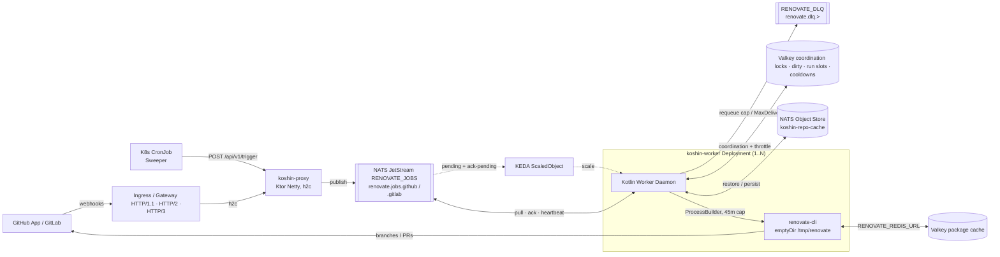
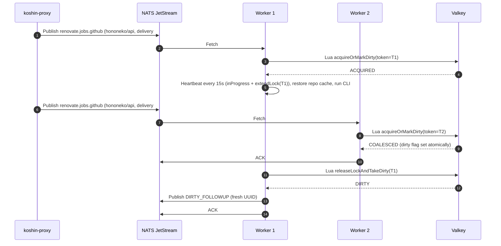

# System Architecture v3.1: `hononeko/koshin`
**Stateless, Horizontally Scalable Renovate CLI Orchestrator (Choreography & Hexagonal Design)**

## 1. System Overview & Core Principles

`hononeko/koshin` is a cloud-native, event-driven orchestrator for the open-source Mend Renovate CLI (`renovate-cli`). It overcomes the single-instance limitation of Renovate Community Edition without relying on heavy Kubernetes Job cold starts or centralized stateful coordinators.

**Monorepo:** everything lives in a single repository, **`github.com/hononeko/koshin`**: all Gradle modules, Dockerfiles, Kustomize manifests, the Helm chart, docs and CI workflows. One Conventional-Commits version (via `hononeko/actions`) covers both images and the chart.

### Architectural Pillars
1. **Choreography over Orchestration:** No central brain. A **Stateless Thin Proxy** (`:proxy`) validates and translates webhooks into queue events; **Autonomous Stateless Workers** (`:worker`) pull jobs, coordinate per-repository locks, and invoke `renovate-cli`.
2. **Hexagonal Architecture (Ports & Adapters):** Queueing, repository coordination, throttling, repo-cache sync and platform credentials live behind Kotlin interfaces in `:core`. NATS JetStream and Valkey are pluggable adapters. The queue ports follow JetStream semantics (per-message ack, in-progress heartbeat, delayed NAK); Valkey Streams fits them, while Kafka/RabbitMQ would need semantic shims.
3. **Stateless Compute:** `:proxy` and `:worker` are plain `Deployment`s with no PVCs. Workers use an `emptyDir` at `/tmp/renovate` and **delete each repo workspace after the run**. The Renovate toolchain ships in the pinned `renovate:full` image (`RENOVATE_BINARYSOURCE=global`); in-cluster **Spegel** distributes its layers P2P so cold worker pods start fast. Backing services (NATS, Valkey) come in two deployment profiles (§8).
4. **Zero Dropped Commits (Atomic Dirty-Flag Coalescing):** A worker atomically either acquires the per-repo lock **or** marks the repo dirty (single Lua script), then ACKs the duplicate. On release, the lock holder atomically releases the lock and takes the dirty flag, and schedules a single coalesced follow-up run.
5. **In-Flight Heartbeats & Fast Crash Recovery:** A heartbeat coroutine every 15s sends `msg.inProgress()` and extends the owner-tokened Valkey lock (TTL 45s). AckWait (60s) is longer than the lock TTL, so a crashed worker's lock has always expired by the time its job is redelivered. A worker that loses its lock kills its CLI process immediately.
6. **Rate-Limit Aware:** Global per-platform run-slot caps, Renovate per-host request limits, and a platform-wide exponential cooldown on rate limits keep workers from hammering Git provider APIs (§7).

## 2. Reference Tech Stack

* **Language & Runtime:** Kotlin **2.3+** on **JDK 25** (`kotlin { jvmToolchain(25) }`).
* **Build System:** Gradle **9.4+** multi-module build with Version Catalogs.
* **HTTP Server:** Ktor **3.x** on the **Netty** engine, `embeddedServer(Netty, configure = { enableHttp2 = true; enableH2c = true })`:
  * `h2c` (cleartext, via `Upgrade: h2c` or prior knowledge) for the in-cluster hop behind the ingress;
  * `h2` via TLS/ALPN on TLS connectors;
  * HTTP/1.1 stays available, since GitHub/GitLab webhook deliveries use it.

  Verified in Ktor 3.6.0: `enableHttp2` defaults to `true`, `enableH2c` to `false`.
* **HTTP/3 (best effort):** Ktor's engine builder doesn't expose Netty's QUIC/HTTP/3 codecs. HTTP/3 (QUIC) is terminated at the ingress/gateway (e.g. Traefik/Envoy), which routes to the proxy over h2c. A time-boxed spike (KSH-6) explores serving it directly.
* **HTTP Client & Async:** Ktor Client (`Java` engine, HTTP/2), Kotlin Coroutines, `kotlinx.serialization`.
* **Message Broker:** **NATS JetStream** (`io.nats:jnats`): `RENOVATE_JOBS` WorkQueue stream with per-platform subjects, `RENOVATE_DLQ` stream; **JetStream Object Store** bucket `koshin-repo-cache` for Renovate repository caches.
* **State & Cache:** **Valkey** via Lettuce (coroutines), used for coordination (locks, dirty flags, run slots, cooldowns) and Renovate's package cache (`RENOVATE_REDIS_URL`). These can be separate instances.
* **Git Provider Auth:** **GitHub App** (installation tokens minted per run) or PAT; GitLab PAT or group token.
* **Autoscaling:** **KEDA** `ScaledObject` (`nats-jetstream` trigger per platform consumer, `lagThreshold: "1"`).
* **Packaging:** Kustomize (base + `minimal` / `ha` overlays) and a Helm chart.
* **CI/CD:** GitHub Actions using the shared composite actions in **`hononeko/actions`** (version, release notes, smoke test, publish image, snapshot pruning, and `gradle-setup`).
* **Container Images:**
  * Proxy: `eclipse-temurin:25-jre-noble`
  * Worker: pinned `ghcr.io/renovatebot/renovate:<version>-full` + Temurin 25 JRE.
* **Testing:** JUnit 5, MockK, Ktor `testApplication` / `MockEngine`, Testcontainers (NATS & Valkey), Kover coverage, Detekt static analysis.
* **Licensing:** Source **Apache-2.0**; distributed `koshin-worker` image (bundles `renovate-cli`) **AGPL-3.0**.

## 3. High-Level Topology


In the `minimal` profile, VK and VC are the same single Valkey instance.

## 4. Hexagonal Architecture & Repository Layout

### 4.1. Monorepo layout (`github.com/hononeko/koshin`)

```text
koshin/
├── .github/workflows/        # pr.yml, cd.yml, snapshot-cleanup.yml (hononeko/actions)
├── .java-version             # JDK pin read by hononeko/actions/gradle-setup (e.g. 25)
├── gradle/libs.versions.toml
├── config/detekt/detekt.yml
├── docker/ (Dockerfile.proxy, Dockerfile.worker)
├── k8s/
│   ├── base/                 # proxy, worker, scaledobject, cronjob-sweeper
│   └── overlays/
│       ├── minimal/          # 1x NATS (emptyDir), 1x Valkey (emptyDir)
│       └── ha/               # 3x NATS (R3, PVC), Valkey Sentinel (AOF, PVC)
├── charts/koshin/            # Helm chart
├── github-app/manifest.json  # GitHub App manifest
├── core/                     # dev.hononeko.koshin.core.{model,ports,usecase}, zero infra deps
├── adapters/
│   ├── nats/                 # JetStream queue, DLQ forwarder, Object Store repo cache
│   ├── state-valkey/         # RepoCoordinationPort + PlatformThrottlePort
│   └── github-app/           # GitHub App credentials + repository discovery
├── proxy/                    # Ktor (Netty) webhook & trigger server
└── worker/                   # Coroutine worker daemon + CLI runner
```

### 4.2. Core Contracts (`:core`)

```kotlin
// core.model
@Serializable enum class Platform { GITHUB, GITLAB }
@Serializable enum class TriggerReason { WEBHOOK, SCHEDULE, DIRTY_FOLLOWUP, RATE_LIMIT_REQUEUE }
@Serializable data class RepoRef(val platform: Platform, val repository: String)
@Serializable data class RenovateJobEvent(
    val repo: RepoRef,
    val deliveryId: String,          // webhook delivery ID, otherwise ALWAYS a fresh UUID
    val triggerReason: TriggerReason,
    val rateLimitAttempt: Int = 0,   // incremented per RATE_LIMIT_REQUEUE; DLQ past MAX_RATE_LIMIT_REQUEUES
)
sealed interface JobExecutionResult {
    data object Success : JobExecutionResult
    data class Failed(val exitCode: Int) : JobExecutionResult
    data object TimedOut : JobExecutionResult
    data class RateLimited(val retryAfter: Duration?) : JobExecutionResult
}

// core.ports
interface JobQueuePublisher {
    suspend fun publish(event: RenovateJobEvent)
    suspend fun publishToDeadLetter(event: RenovateJobEvent)
}
interface JobDelivery {
    val event: RenovateJobEvent
    val deliveryAttempt: Int
    suspend fun ack(); suspend fun nack(delay: Duration = Duration.ZERO); suspend fun heartbeat()
}
interface JobQueueConsumer { suspend fun fetchNext(platform: Platform, timeout: Duration): JobDelivery? }

enum class AcquireResult { ACQUIRED, COALESCED }
enum class ReleaseResult { CLEAN, DIRTY, NOT_OWNER }
interface RepoCoordinationPort {
    suspend fun acquireOrMarkDirty(repo: RepoRef, token: String, lockTtl: Duration, dirtyTtl: Duration): AcquireResult
    suspend fun extendLock(repo: RepoRef, token: String, ttl: Duration): Boolean
    suspend fun releaseLockAndTakeDirty(repo: RepoRef, token: String): ReleaseResult
    suspend fun releaseLock(repo: RepoRef, token: String): Boolean   // keeps dirty flag (shutdown / requeue)
}
interface PlatformThrottlePort {
    suspend fun tryAcquireRunSlot(platform: Platform, token: String, ttl: Duration): Boolean
    suspend fun extendRunSlot(platform: Platform, token: String, ttl: Duration): Boolean
    suspend fun releaseRunSlot(platform: Platform, token: String)
    suspend fun cooldownRemaining(platform: Platform): Duration?
    suspend fun registerRateLimit(platform: Platform, retryAfter: Duration?): Duration
    suspend fun resetBackoff(platform: Platform)
}
interface RepoCachePort { suspend fun restore(repo: RepoRef): Boolean; suspend fun persist(repo: RepoRef) }
interface PlatformCredentialsPort { suspend fun credentialsFor(repo: RepoRef): PlatformCredentials }
interface RepositoryDiscoveryPort { suspend fun discover(): List<RepoRef> }
interface CliExecutorPort { suspend fun execute(repo: RepoRef, creds: PlatformCredentials, timeout: Duration): JobExecutionResult }
interface WorkspaceCleanerPort { suspend fun cleanup(repo: RepoRef); suspend fun purgeAll() }
```

### 4.3. Health endpoints
* `GET /healthz`: **liveness** only (process up, no dependency checks), so CI smoke tests can boot a single container.
* `GET /readyz`: **readiness** (proxy: NATS; worker: NATS + Valkey).

## 5. Concurrency & Dirty-Flag Coalescing Protocol

Keys use hash tags so multi-key scripts work on Valkey Cluster: `koshin:{<platform>:<repo>}:lock`, `koshin:{<platform>:<repo>}:dirty`.



### Lua scripts
```lua
-- acquireOrMarkDirty: KEYS[1]=lock KEYS[2]=dirty ARGV[1]=token ARGV[2]=lockTtl ARGV[3]=dirtyTtl
if redis.call("SET", KEYS[1], ARGV[1], "NX", "EX", ARGV[2]) then return 1 end
redis.call("SET", KEYS[2], "1", "EX", ARGV[3])
return 0

-- extendLock: KEYS[1]=lock ARGV[1]=token ARGV[2]=ttl
if redis.call("GET", KEYS[1]) == ARGV[1] then return redis.call("EXPIRE", KEYS[1], ARGV[2]) end
return 0

-- releaseLockAndTakeDirty: returns -1 NOT_OWNER, 1 DIRTY, 0 CLEAN
if redis.call("GET", KEYS[1]) ~= ARGV[1] then return -1 end
redis.call("DEL", KEYS[1])
if redis.call("GETDEL", KEYS[2]) then return 1 end
return 0

-- releaseLock (keeps dirty): KEYS[1]=lock ARGV[1]=token
if redis.call("GET", KEYS[1]) == ARGV[1] then return redis.call("DEL", KEYS[1]) end
return 0
```

## 6. Worker Job Lifecycle & Failure Handling

1. For each enabled platform **not in cooldown**: `tryAcquireRunSlot` → `fetchNext(platform)` → release the slot if nothing was fetched.
2. `acquireOrMarkDirty` → `COALESCED`: ACK if `deliveryAttempt == 1`; if it's a redelivery (the previous holder probably crashed), NAK with `LOCK_COLLISION_RETRY_SECONDS`.
3. `ACQUIRED`: start the heartbeat (delivery heartbeat + `extendLock` + `extendRunSlot`). If `extendLock` returns false, kill the CLI.
4. `RepoCachePort.restore` → `CliExecutorPort.execute` → handle the result:

| Outcome | Lock release | Repo cache | Delivery |
| :--- | :--- | :--- | :--- |
| `Success` | `releaseLockAndTakeDirty` (DIRTY → publish follow-up) | `persist` | ACK, `resetBackoff` |
| `Failed` / `TimedOut` | `releaseLockAndTakeDirty` | not persisted | ACK (next webhook or sweep retries) |
| `RateLimited` | `releaseLock` (keep dirty) | not persisted | `registerRateLimit` → if `rateLimitAttempt < MAX_RATE_LIMIT_REQUEUES`: publish `RATE_LIMIT_REQUEUE` (fresh UUID, `rateLimitAttempt + 1`), else `publishToDeadLetter`; ACK |
| Lost lock / `NOT_OWNER` | n/a | not persisted | NAK |
| Infra error (Valkey/NATS) | best effort `releaseLock` | not persisted | NAK with backoff by `deliveryAttempt` |
| SIGTERM | kill CLI, `releaseLock` (keep dirty) | not persisted | NAK(0) |

5. Always: cancel the heartbeat, `WorkspaceCleanerPort.cleanup(repo)`, `releaseRunSlot`.
6. **`MaxDeliver` exhaustion → DLQ:** every worker runs a forwarder subscribed to `$JS.EVENT.ADVISORY.CONSUMER.MAX_DELIVERIES.RENOVATE_JOBS.*` in **queue group `koshin-dlq-forwarders`**, so exactly one worker handles each advisory.
   * The advisory carries only metadata, so the forwarder reads `stream_seq` from it.
   * WorkQueue streams only delete on ACK, so the exhausted message is still stored there. It reads the original message with `jsm.getMessage("RENOVATE_JOBS", stream_seq)`.
   * It republishes to `renovate.dlq.<platform>` (`Nats-Msg-Id = dlq:RENOVATE_JOBS:<stream_seq>`, so retries can't duplicate), then calls `jsm.deleteMessage`.

## 7. Rate Limiting

* **Prevention:** a global run-slot semaphore per platform (`MAX_CONCURRENT_RUNS_PER_PLATFORM`, a Valkey ZSET with leases renewed by the heartbeat) plus Renovate `hostRules` (`maxRequestsPerSecond`, `concurrentRequestLimit`) injected per run. API budget ≈ run slots × requests/s per run.
* **Server-side clock:** the ZSET lease scripts read `redis.call('TIME')` inside Lua to compute "now" and expiry, never a JVM timestamp passed as an ARGV, so pod clock skew can't corrupt leases.
* **Detection:** the CLI executor parses Renovate JSON logs for rate-limit errors (configurable pattern), since Renovate exits 0 when it aborts a repository on a rate limit: `Rate limit exceeded - aborting` on GitHub, a `Host error` with `hostType` = the platform and status 429 on GitLab. `Retry-After` / `x-ratelimit-reset` come from the logged response headers when present (secondary limits, GitLab 429s). Rate-limit signals for koshin's own HTTP calls: **429**, **403 + `x-ratelimit-remaining: 0`**, and GitHub secondary-limit responses.
* **Backoff:** a platform-wide cooldown `koshin:{throttle:<platform>}:cooldown` lasting `Retry-After`/reset time if known, otherwise `min(base × 2^n, max) ± 20% jitter`. `n` resets after a successful run. Workers stop fetching from a platform's consumer during its cooldown, so pending jobs wait without spending `MaxDeliver` attempts.
* **Requeue cap:** a rate-limited job is republished at most `MAX_RATE_LIMIT_REQUEUES` (default 5) times, tracked in `RenovateJobEvent.rateLimitAttempt`, then dead-lettered. Without the cap, a permanent failure that matches the rate-limit pattern would loop across cooldowns forever.
* **koshin's own HTTP calls** (GitHub App tokens, discovery) use a shared Ktor client with `HttpRequestRetry` + `exponentialDelay()` and honor `Retry-After`.
* KEDA counts pending jobs during a cooldown and may scale up idle pods; keep `maxReplicaCount` modest.

## 8. Deployment Profiles

| | **minimal** | **ha** |
| :--- | :--- | :--- |
| NATS | 1 replica, `emptyDir`, stream/bucket R1 | 3-node StatefulSet + PVCs, R3 |
| Valkey (coordination) | 1 replica, `emptyDir`, shared with package cache, `noeviction` + sized `maxmemory` | Primary + replicas + 3 Sentinels, AOF on PVC, `noeviction` |
| Valkey (package cache) | same instance | separate single instance, `allkeys-lru`, `emptyDir` (it's only a cache) |
| On restart | pending jobs, locks and repo caches lost; the sweeper recovers | survives losing one node |

**Autoscaling:** the KEDA `nats-jetstream` scaler computes lag as `num_pending + num_ack_pending` (verified in KEDA v2.21.0), so in-flight runs count. With 1 job per pod, `lagThreshold: "1"` scales workers one-to-one with active + pending jobs. Kubernetes picks which pod to remove on scale-in without knowing which are busy, so workers set `controller.kubernetes.io/pod-deletion-cost` while busy (KSH-8); the SIGTERM path keeps a wrong pick safe.

Packaged as Kustomize overlays (KSH-8 / KSH-12) and a Helm chart (KSH-13).

## 9. Environment Variables Contract

| Variable | Component | Default | Description |
| :--- | :--- | :--- | :--- |
| `PORT` | Both | `8080` | HTTP port (`/healthz`, `/readyz`, webhooks) |
| `HTTP2_ENABLED` | Both | `true` | HTTP/2 on Netty (`enableHttp2` + `enableH2c`; `h2` with TLS) |
| `PLATFORMS` | Both | `github` | Enabled platforms (`github`, `gitlab`) |
| `NATS_URL` | Both | `nats://koshin-nats:4222` | NATS connection URL |
| `NATS_STREAM_NAME` | Both | `RENOVATE_JOBS` | WorkQueue stream name |
| `NATS_STREAM_REPLICAS` | Both | `1` | Stream / Object Store replicas (`3` in HA) |
| `NATS_ACK_WAIT_SECONDS` | Worker | `60` | Must be > `LOCK_TTL_SECONDS` |
| `NATS_MAX_DELIVER` | Worker | `5` | Redelivery cap before DLQ |
| `GITHUB_WEBHOOK_SECRET` | Proxy | — | HMAC secret for `X-Hub-Signature-256` (GitHub App webhook secret) |
| `GITLAB_WEBHOOK_SECRET` | Proxy | — | Shared token for `X-Gitlab-Token` (constant-time compare) |
| `INTERNAL_TRIGGER_TOKEN` | Proxy | — | Bearer token for `POST /api/v1/trigger` |
| `SWEEP_REPOSITORIES_FILE` | Proxy | — | Static repo list for discovery (when not using the GitHub App) |
| `VALKEY_URL` | Worker | `redis://koshin-valkey:6379` | Coordination Valkey (`redis://` or `redis-sentinel://`) |
| `RENOVATE_REDIS_URL` | Worker | `$VALKEY_URL` | Renovate package cache Valkey |
| `LOCK_TTL_SECONDS` | Worker | `45` | Per-repo lock TTL |
| `HEARTBEAT_INTERVAL_SECONDS` | Worker | `15` | Heartbeat / lock / run-slot renewal interval |
| `DIRTY_TTL_SECONDS` | Worker | `3600` | Must be > `CLI_TIMEOUT_MINUTES` |
| `LOCK_COLLISION_RETRY_SECONDS` | Worker | `30` | NAK delay for a redelivered job that hits a held lock |
| `CLI_TIMEOUT_MINUTES` | Worker | `45` | Hard cap per `renovate-cli` run (`+ 5` must stay < 60 for GitHub App tokens) |
| `RENOVATE_BASE_DIR` | Worker | `/tmp/renovate` | Workspace (`emptyDir`) |
| `RENOVATE_BINARYSOURCE` | Worker | `global` | Tools come from the `full` image |
| `REPO_CACHE_PROVIDER` | Worker | `nats` | `nats` (Object Store sync), `s3` (native Renovate, e.g. SeaweedFS), `local` |
| `REPO_CACHE_BUCKET` | Worker | `koshin-repo-cache` | Object Store bucket |
| `REPO_CACHE_MAX_BYTES` | Worker | — (unlimited) | Bucket size cap; uploads are skipped while it's full |
| `REPO_CACHE_TTL_DAYS` | Worker | — (forever) | Drops caches of repos without a successful run for this long |
| `RENOVATE_CACHE_DIR` | Worker | `$RENOVATE_BASE_DIR/cache` | Renovate's cache dir; the repo cache file is `renovate/repository/<platform>/<repo>.json` under it |
| `RENOVATE_REPOSITORY_CACHE_TYPE` / `RENOVATE_S3_ENDPOINT` / `RENOVATE_S3_PATH_STYLE` | Worker | — / — / `true` | Used when `REPO_CACHE_PROVIDER=s3` (`s3://<bucket>/<prefix>/`); the legacy `RENOVATE_X_S3_*` names are accepted |
| `MAX_CONCURRENT_RUNS_PER_PLATFORM` | Worker | `3` | Global run-slot cap per platform |
| `RENOVATE_MAX_REQUESTS_PER_SECOND` | Worker | — | Injected into Renovate `hostRules` |
| `RENOVATE_CONCURRENT_REQUEST_LIMIT` | Worker | — | Injected into Renovate `hostRules` |
| `RATE_LIMIT_BACKOFF_BASE_SECONDS` | Worker | `60` | Cooldown base |
| `RATE_LIMIT_BACKOFF_MAX_SECONDS` | Worker | `3600` | Cooldown cap |
| `MAX_RATE_LIMIT_REQUEUES` | Worker | `5` | Rate-limit requeues per job before it's dead-lettered |
| `RATE_LIMIT_LOG_PATTERN` | Worker | `^Rate limit exceeded - aborting$` | Regex for the Renovate log message of a run aborted by the platform's rate limit |
| `GITHUB_APP_ID` / `GITHUB_APP_PRIVATE_KEY_PATH` | Both | — | GitHub App auth (preferred) |
| `GITHUB_TOKEN` | Worker | — | PAT fallback when the App isn't configured |
| `GITHUB_API_URL` | Both | `https://api.github.com` | GHES support |
| `GITLAB_TOKEN` / `GITLAB_ENDPOINT` | Worker | — | GitLab credentials |

## 10. Changelog v3.0 → v3.1
* Atomic `acquireOrMarkDirty`; owner-tokened locks; lost lock kills the CLI.
* Timings: lock TTL 45s, heartbeat 15s, AckWait 60s; NAK on redelivery collision.
* Fresh UUIDs for follow-up, schedule and requeue events (NATS dedup).
* `platform` added to the event and keys; per-platform subjects/consumers (lossy repo-in-subject mapping removed); hash-tagged keys.
* Proxy filters out Renovate-triggered webhooks.
* Failure-handling matrix; DLQ for `MaxDeliver` exhaustion via a queue-grouped advisory forwarder (`getMessage` by `stream_seq` → DLQ → `deleteMessage`).
* Rate-limit requeues capped by `rateLimitAttempt` / `MAX_RATE_LIMIT_REQUEUES`, then dead-lettered.
* Run-slot leases use Valkey's `TIME`, not JVM clocks.
* LRU disk manager dropped (workspace deleted per run); `renovate:full` + Spegel + `binarySource=global`.
* Repository cache via NATS Object Store sync (or native S3).
* Rate limiting & backoff (§7); GitHub App auth & discovery (token reuse threshold `CLI_TIMEOUT_MINUTES + 5 min` within GitHub's 60-minute lifetime).
* Deployment profiles `minimal` / `ha`; Helm chart; KEDA `lagThreshold: "1"` (ack-pending counted) + pod-deletion-cost.
* Module `:adapters:queue-nats` renamed to `:adapters:nats`; new `:adapters:github-app`.
* Monorepo `hononeko/koshin`; CI via `hononeko/actions` (+ new `gradle-setup`), Detekt + Kover gates.
* HTTP server: CIO replaced by Netty with HTTP/2 (`enableHttp2` + `enableH2c`, verified in Ktor 3.6.0); HTTP/3 at the ingress.
* `/healthz` (liveness, no deps) split from `/readyz` (readiness).
