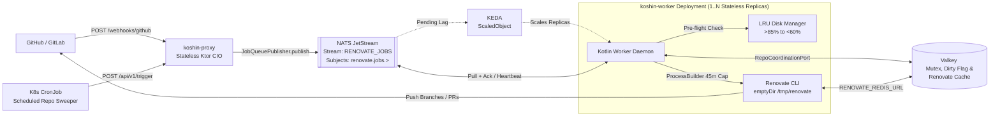
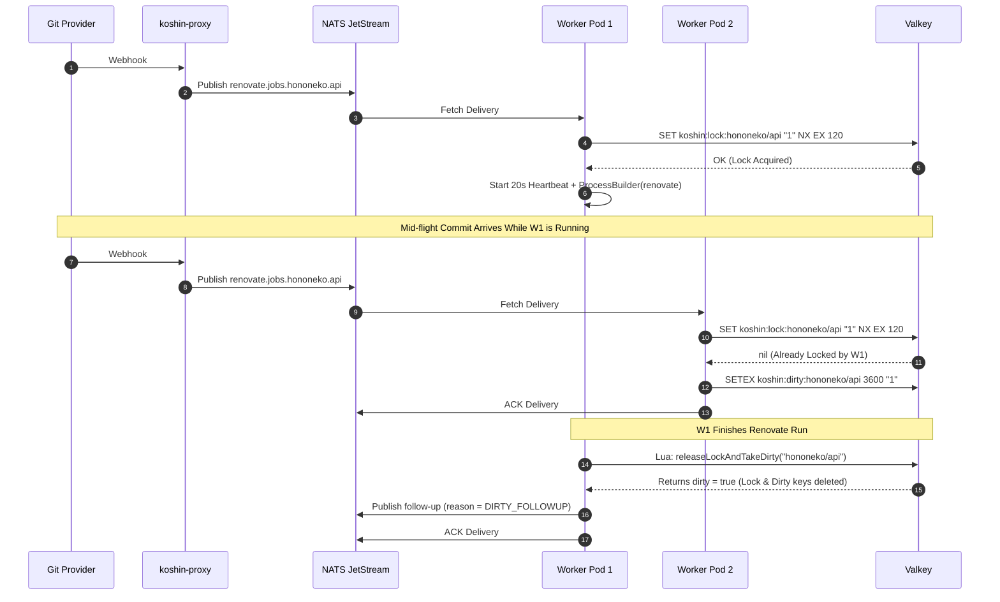

# System Architecture v3.0: `hononeko/koshin`
**Stateless, Horizontally Scalable Renovate CLI Orchestrator (Choreography & Hexagonal Design)**

---

## 1. System Overview & Core Principles

`hononeko/koshin` is a cloud-native, event-driven orchestrator for the open-source Mend Renovate CLI (`renovate-cli`). It overcomes the single-instance limitation of Renovate Community Edition without relying on heavy Kubernetes Job cold starts, StatefulSets, or centralized stateful coordinators.

### Architectural Pillars
1. **Choreography over Orchestration:** There is no central brain tracking workflow state. A **Stateless Thin Proxy** (`:proxy`) validates and translates incoming webhooks into queue events, while **Autonomous Stateless Workers** (`:worker`) pull jobs, coordinate per-repository locks, and invoke `renovate-cli`.
2. **Hexagonal Architecture (Ports & Adapters):** All message queueing (`JobQueuePublisher`, `JobQueueConsumer`) and repository coordination (`RepoCoordinationPort`) live behind strict Kotlin interfaces in `:core`. NATS JetStream and Valkey are implemented as pluggable outbound adapters, making it non-breaking to swap in Valkey Streams, Kafka, or RabbitMQ later.
3. **100% Stateless Compute (`Deployment`):** Both `:proxy` and `:worker` run as standard Kubernetes `Deployment` workloads (or Docker Compose services) with zero PersistentVolumeClaims (PVCs). Workers use an `emptyDir` mounted at `/tmp/renovate` backed by an LRU disk manager, shallow Git clones, and `RENOVATE_BINARYSOURCE="install"`.
4. **Zero Dropped Commits (Dirty-Flag Coalescing):** Concurrent webhooks for the same repository never collide or drop updates. If a repository is actively locked by Worker A and a new commit webhook arrives on Worker B, Worker B atomically flips a `dirty` flag in Valkey and immediately ACKs the duplicate queue message. When Worker A finishes, it detects the `dirty` flag and schedules a single coalesced catch-up run.
5. **In-Flight Heartbeats & Fast Crash Recovery:** Instead of setting brittle 60-minute queue timeouts, workers run a background coroutine that sends broker heartbeats (`msg.inProgress()`) and extends the Valkey lock TTL every 20 seconds. If a worker pod is `OOMKilled`, its lock expires in 60 seconds and another worker picks up the job automatically.

---

## 2. Reference Tech Stack

* **Language & Runtime:** Kotlin **2.3+** on **JDK 25** (`kotlin { jvmToolchain(25) }`).
* **Build System:** Gradle **9.4+** multi-module build with Version Catalogs (`gradle/libs.versions.toml`).
* **HTTP & Async Framework:** Ktor **3.x** Server & Client (`CIO` coroutine engine), Kotlin Coroutines (`kotlinx-coroutines-core`), `kotlinx.serialization` (JSON).
* **Default Message Broker Adapter:** **NATS JetStream** (`io.nats:jnats`) using a `WorkQueue` retention stream (`RENOVATE_JOBS` on subjects `renovate.jobs.>`).
* **Default State & Cache Adapter:** **Valkey** via Lettuce (`io.lettuce:lettuce-core` with Kotlin coroutine extensions) for both per-repo mutex/dirty flags and Renovate's global HTTP/AST cache (`RENOVATE_REDIS_URL`).
* **Autoscaling:** **KEDA** (`ScaledObject` targeting the NATS JetStream consumer lag or Valkey Stream length).
* **Container Base Images:**
  * Proxy: `eclipse-temurin:25-jre-noble`
  * Worker: `ghcr.io/renovatebot/renovate:full` layered with Eclipse Temurin 25 JRE.
* **Testing:** JUnit 5, MockK, Ktor `testApplication`, Testcontainers (NATS & Valkey).
* **Licensing:**
  * Source Code (`:core`, `:adapters`, `:proxy`, `:worker`): **Apache-2.0**
  * Distributed `koshin-worker` Container Image (bundles `renovate-cli`): **AGPL-3.0**

---

## 3. High-Level Topology & Choreography Flow



---

## 4. Hexagonal Architecture & Repository Layout

### 4.1. Multi-Module Directory Structure

```text
koshin/
├── settings.gradle.kts
├── build.gradle.kts
├── gradle/
│   └── libs.versions.toml
├── docker/
│   ├── Dockerfile.proxy
│   └── Dockerfile.worker
├── k8s/
│   ├── base/
│   │   ├── kustomization.yaml
│   │   ├── proxy-deployment.yaml
│   │   ├── proxy-service.yaml
│   │   ├── worker-deployment.yaml
│   │   ├── worker-scaledobject.yaml
│   │   ├── cronjob-sweeper.yaml
│   │   ├── nats-statefulset.yaml
│   │   └── valkey-deployment.yaml
├── core/                                      # Pure Kotlin domain & hexagonal ports (zero infra deps)
│   └── src/main/kotlin/dev/hononeko/koshin/core/
│       ├── model/
│       │   ├── RenovateJobEvent.kt
│       │   └── JobExecutionResult.kt
│       ├── ports/
│       │   ├── JobQueuePublisher.kt
│       │   ├── JobQueueConsumer.kt
│       │   ├── RepoCoordinationPort.kt
│       │   └── CliExecutorPort.kt
│       └── usecase/
│           ├── IngestWebhookUseCase.kt
│           └── ProcessRenovateJobUseCase.kt
├── adapters/
│   ├── nats/                                  # NATS JetStream WorkQueue & Object Store adapter
│   │   └── src/main/kotlin/dev/hononeko/koshin/adapter/nats/
│   │       ├── NatsJetStreamConfig.kt
│   │       ├── NatsJobQueuePublisher.kt
│   │       └── NatsJobQueueConsumer.kt
│   ├── state-valkey/                          # Valkey implementation of RepoCoordinationPort
│   │   └── src/main/kotlin/dev/hononeko/koshin/adapter/valkey/
│   │       ├── ValkeyConfig.kt
│   │       └── ValkeyRepoCoordinationAdapter.kt
│   └── github-app/                            # GitHub App authentication & installation token adapter
│       └── src/main/kotlin/dev/hononeko/koshin/adapter/github/
├── proxy/                                     # Stateless Ktor Webhook & Trigger Server
│   └── src/main/kotlin/dev/hononeko/koshin/proxy/
│       ├── ProxyApplication.kt
│       ├── security/HmacSignatureValidator.kt
│       └── routes/WebhookRoutes.kt
└── worker/                                    # Autonomous Coroutine Worker Daemon
    └── src/main/kotlin/dev/hononeko/koshin/worker/
        ├── WorkerApplication.kt
        ├── disk/LruWorkspaceCleaner.kt
        └── cli/RenovateProcessExecutor.kt
```

### 4.2. Core Domain Contracts (`:core`)

```kotlin
package dev.hononeko.koshin.core.ports

import kotlinx.serialization.Serializable
import kotlin.time.Duration

@Serializable
data class RenovateJobEvent(
    val repository: String,          // e.g., "hononeko/koshin"
    val deliveryId: String,          // UUID or GitHub X-GitHub-Delivery
    val triggerReason: TriggerReason // WEBHOOK, SCHEDULE, DIRTY_FOLLOWUP
)

@Serializable
enum class TriggerReason { WEBHOOK, SCHEDULE, DIRTY_FOLLOWUP }

interface JobQueuePublisher {
    suspend fun publish(event: RenovateJobEvent)
}

interface JobDelivery {
    val event: RenovateJobEvent
    suspend fun ack()
    suspend fun nack(delay: Duration = Duration.ZERO)
    suspend fun heartbeat()
}

interface JobQueueConsumer {
    suspend fun fetchNext(timeout: Duration): JobDelivery?
}

interface RepoCoordinationPort {
    suspend fun tryAcquireLock(repository: String, ttl: Duration): Boolean
    suspend fun extendLock(repository: String, ttl: Duration): Boolean
    suspend fun markDirty(repository: String, ttl: Duration)
    suspend fun releaseLockAndTakeDirty(repository: String): Boolean
}
```

---

## 5. Concurrency & Dirty-Flag Coalescing Protocol



### Valkey Atomic Release & Dirty Check Lua Script
```lua
-- KEYS[1] = koshin:lock:<repo>
-- KEYS[2] = koshin:dirty:<repo>
redis.call("DEL", KEYS[1])
local wasDirty = redis.call("GETDEL", KEYS[2])
if wasDirty then
    return 1
else
    return 0
end
```

---

## 6. Environment Variables Contract

| Variable | Component | Required | Default | Description |
| :--- | :--- | :--- | :--- | :--- |
| `PORT` | Proxy / Worker | No | `8080` | HTTP port for `/healthz` and webhook ingestion |
| `QUEUE_PROVIDER` | Both | No | `nats` | Queue adapter selector (`nats`) |
| `NATS_URL` | Both | Yes | `nats://koshin-nats:4222` | NATS JetStream connection URL |
| `NATS_STREAM_NAME` | Both | No | `RENOVATE_JOBS` | JetStream WorkQueue stream name |
| `GITHUB_WEBHOOK_SECRET` | Proxy | Yes | — | HMAC secret for `X-Hub-Signature-256` validation |
| `INTERNAL_TRIGGER_TOKEN` | Proxy | Yes | — | Bearer token for `POST /api/v1/trigger` (used by CronJob) |
| `VALKEY_URL` | Worker | Yes | `redis://koshin-valkey:6379` | Valkey connection URL for locks and Renovate cache |
| `LOCK_TTL_SECONDS` | Worker | No | `120` | Per-repo lock TTL in Valkey (extended every 20s) |
| `HEARTBEAT_INTERVAL_SECONDS` | Worker | No | `20` | Interval for `JobDelivery.heartbeat()` and lock renewal |
| `CLI_TIMEOUT_MINUTES` | Worker | No | `45` | Hard execution cap for a single `renovate-cli` subprocess |
| `RENOVATE_BASE_DIR` | Worker | No | `/tmp/renovate` | Workspace directory for Git clones and containerbase cache |
| `DISK_HIGH_WATERMARK_PCT` | Worker | No | `85` | Disk usage percentage on `RENOVATE_BASE_DIR` that triggers LRU pruning |
| `DISK_LOW_WATERMARK_PCT` | Worker | No | `60` | Target disk usage percentage after LRU eviction completes |
| `RENOVATE_BINARYSOURCE` | Worker | No | `install` | Rootless isolated tool installation via containerbase |
| `RENOVATE_TOKEN` | Worker | Yes | — | GitHub/GitLab PAT or App token passed to `renovate-cli` |