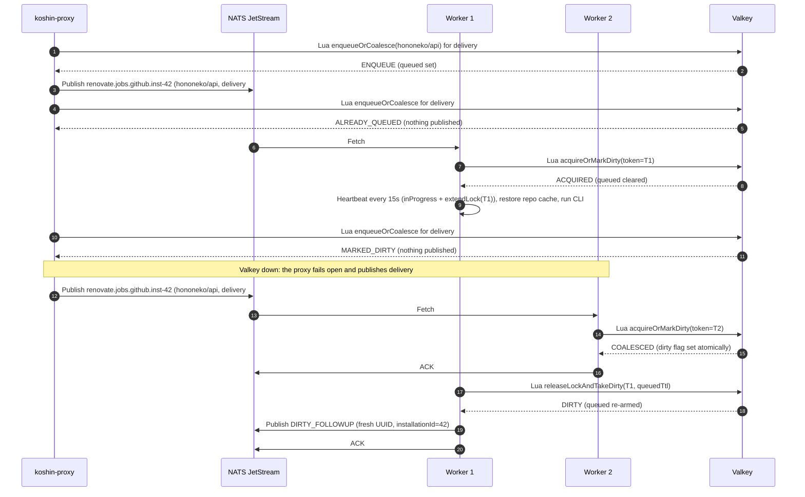

# System Architecture v3.2: `hononeko/koshin`
**Stateless, Scale-to-Zero / Warm-Baseline Renovate CLI Orchestrator (Lightweight Proxy Dispatch & Hexagonal Design)**

## 1. System Overview & Core Principles

`hononeko/koshin` is a cloud-native, event-driven orchestrator for the open-source Mend Renovate CLI (`renovate-cli`). It overcomes the single-instance limitation of Renovate Community Edition with configurable scale-to-zero (`minReplicas: 0`) or single warm-worker (`minReplicas: 1`) operation, burst Kubernetes `Job` workers, pre-queue duplicate coalescing, and zero external autoscaler dependencies (no KEDA).

**Monorepo:** everything lives in a single repository, **`github.com/hononeko/koshin`**: all Gradle modules, Dockerfiles, Kustomize manifests, the Helm chart, docs and CI workflows. One Conventional-Commits version (via `hononeko/actions`) covers both images and the chart.

### Architectural Pillars
1. **Lightweight Proxy Coordinator + Autonomous Workers:** An always-on **Lightweight Proxy** (`:proxy`, ~150 MB JRE) validates webhooks, performs fail-open pre-queue Valkey coalescing (`QUEUED` / `RUNNING` + `DIRTY`, KSH-30), runs NATS consumer/DLQ housekeeping, and directly dispatches burst Kubernetes `batch/v1` `Job` workers cloned from a `v1/PodTemplate` (KSH-32). **Workers** (`:worker`, KSH-31) operate either as burst `Job`s (`0..maxReplicas`) that drain runnable work back-to-back and voluntarily exit `0` once idle (`WORKER_IDLE_TIMEOUT_SECONDS`), plus an optional fixed `replicas: 1` warm `Deployment` pod (`worker.autoscaling.minReplicas: 1`, `WORKER_IDLE_TIMEOUT_SECONDS=0`) for zero-cold-start single-job pickup—requiring zero KEDA CRDs and zero `Deployment` scale-in coordination.
2. **Hexagonal Architecture (Ports & Adapters):** Queueing, repository coordination, throttling, repo-cache sync, worker dispatch and platform credentials live behind Kotlin interfaces in `:core`. NATS JetStream and Valkey are pluggable adapters. The queue ports follow JetStream semantics (per-message ack, in-progress heartbeat, delayed NAK); Valkey Streams fits them, while Kafka/RabbitMQ would need semantic shims.
3. **Stateless Compute (`minReplicas: 0 | 1`):** `:proxy` is a plain `Deployment`. When `worker.autoscaling.minReplicas=0`, `0` worker pods run when idle and `:proxy` spawns `1..maxReplicas` `batch/v1` `Job` pods on demand. When `minReplicas=1`, a fixed 1-replica `Deployment` stays warm (rolling cleanly on `helm upgrade` / image bumps with zero churn) while `:proxy` spawns `0..(maxReplicas - 1)` burst `Job` pods during sweeps/bursts. No PVCs. Workers use an `emptyDir` at `/tmp/renovate` and **delete each repo workspace and local cache after the run**. The Renovate toolchain ships in the pinned upstream `renovate:full` image (`RENOVATE_BINARYSOURCE=global`) that the worker pod's `renovate` sidecar runs; in-cluster **Spegel** distributes its layers P2P so cold worker pods start fast. Backing services (NATS, Valkey) come in two deployment profiles (§8).
4. **Zero Dropped Commits (Pre-Queue + Dirty-Flag Coalescing):** `:proxy` atomically coalesces duplicates before publishing (`IDLE` → `QUEUED` + publish; `QUEUED` → drop duplicate; `RUNNING` → set `dirty=1`), failing open to direct NATS publish if Valkey is unreachable during a Sentinel failover (KSH-30). On the worker side, `acquireOrMarkDirty` clears `queued`, acquires `:lock` (or marks `:dirty` if a fail-open duplicate arrived), and `releaseLockAndTakeDirty` atomically schedules a single `DIRTY_FOLLOWUP` run.
5. **In-Flight Heartbeats & Fast Crash Recovery:** A heartbeat coroutine every 15s sends `msg.inProgress()` and extends the owner-tokened Valkey lock (TTL 45s). AckWait (60s) is longer than the lock TTL, so a crashed worker's lock has always expired by the time its job is redelivered. A worker that loses its lock kills its CLI process immediately.
6. **Rate-Limit Aware & Tenant-Isolated:** A global concurrency cap plus per-credential run-slot caps (`github:inst-<id>`, `github:pat`, `gitlab:pat`), Renovate per-host request limits, per-credential exponential cooldowns, and cooldown-aware `Job` dispatch keep workers from hammering Git provider APIs or spawning idle pods during rate-limit windows while isolating tenants from one another (§7).

## 2. Reference Tech Stack

* **Language & Runtime:** Kotlin **2.3+** on **JDK 25** (`kotlin { jvmToolchain(25) }`).
* **Build System:** Gradle **9.4+** multi-module build with Version Catalogs.
* **HTTP Server:** Ktor **3.x** on the **Netty** engine, `embeddedServer(Netty, configure = { enableHttp2 = true; enableH2c = true })`:
  * `h2c` (cleartext, via `Upgrade: h2c` or prior knowledge) for the in-cluster hop behind the ingress;
  * `h2` via TLS/ALPN on TLS connectors;
  * HTTP/1.1 stays available, since GitHub/GitLab webhook deliveries use it.

  Verified in Ktor 3.6.0: `enableHttp2` defaults to `true`, `enableH2c` to `false`.
* **HTTP/3 (best effort):** Ktor's engine builder doesn't expose Netty's QUIC/HTTP/3 codecs. HTTP/3 (QUIC) is terminated at the ingress/gateway (e.g. Traefik/Envoy), which routes to the proxy over h2c. A time-boxed spike (KSH-6) explores serving it directly.
* **HTTP Client & Async:** Ktor Client (`CIO` engine for GitHub; `Java` engine, i.e. JDK TLS trusting the ServiceAccount CA, for the dispatcher's in-cluster Kubernetes API client), Kotlin Coroutines, `kotlinx.serialization`.
* **Message Broker:** **NATS JetStream** (`io.nats:jnats`): `RENOVATE_JOBS` WorkQueue stream partitioned by credential scope (`renovate.jobs.<platform>.<scope>`), `RENOVATE_DLQ` stream; **JetStream Object Store** bucket `koshin-repo-cache` for Renovate repository caches.
* **State & Cache:** **Valkey** via Lettuce (coroutines), used for coordination (queued/lock/dirty state, run slots, cooldowns, warm-worker presence, `:proxy` dispatcher leader lease) and Renovate's package cache (`RENOVATE_REDIS_URL`). These can be separate instances.
* **Git Provider & Registry Auth:** **GitHub App** (installation tokens minted per installation and reused while at least `CLI_TIMEOUT_MINUTES + 5` minutes remain; public visibility gated by `GITHUB_APP_ALLOWED_ACCOUNTS`) or PAT; GitLab PAT or group token; Renovate OpenPGP-encrypted secrets (`RENOVATE_PRIVATE_KEY_PATH`) for tenant-supplied private registries.
* **Autoscaling & Worker Dispatch (KSH-31, KSH-32):** Built-in Kubernetes `batch/v1` `Job` dispatcher in `:proxy` (Valkey leader-elected across replicas), cloning burst worker pods from a chart-rendered `v1/PodTemplate` (`<fullname>-worker`) based on runnable non-cooled-down queue demand minus live warm baseline capacity (`worker.autoscaling.minReplicas: 0 | 1`). No external KEDA dependency.
* **Packaging:** a Helm chart with `minimal` / `ha` profiles (primary), plus a Kustomize `minimal` reference.
* **CI/CD:** GitHub Actions using the shared composite actions in **`hononeko/actions`** (version, release notes, smoke test, publish image, snapshot pruning, and `gradle-setup`).
* **Container Images:**
  * Proxy: `eclipse-temurin:25-jre-noble`
  * Worker (`koshin-worker`, KSH-27): `eclipse-temurin:25-jre-noble` (~150 MB compressed, ~520 MB unpacked, like the proxy), also used by `koshin-runner-init` to populate `/opt/koshin` (`jre`, `lib`, `bin/koshin-runner`) into a read-only `emptyDir` for the `renovate` sidecar.
  * Renovate runner sidecar (`renovate`, KSH-21 / KSH-27): upstream pinned `ghcr.io/renovatebot/renovate:<version>-full` (`worker.renovate.image` in Helm, updated weekly via batched Renovate `packageRules`).
* **Testing:** JUnit 5, MockK, Ktor `testApplication` / `MockEngine`, Testcontainers (NATS & Valkey), Kover coverage, Detekt static analysis.
* **Licensing:** Source and distributed `koshin-proxy` / `koshin-worker` images **Apache-2.0** (since KSH-27 neither bundles `renovate-cli`; upstream `ghcr.io/renovatebot/renovate` is **AGPL-3.0**).

## 3. High-Level Topology

```mermaid
graph LR
    Git[GitHub App / GitLab]
    Cron[K8s CronJob <br/> Sweeper]
    Ingress[Ingress / Gateway <br/> HTTP/1.1 · HTTP/2 · HTTP/3]
    Proxy[koshin-proxy <br/> Ingest · Coalesce · DLQ Sweep · Job Dispatcher]
    Queue[[NATS JetStream <br/> RENOVATE_JOBS <br/> renovate.jobs.github.* / .gitlab.pat]]
    DLQ[[RENOVATE_DLQ <br/> renovate.dlq.>]]
    OS[(NATS Object Store <br/> koshin-repo-cache)]
    VK[(Valkey coordination <br/> queued · locks · dirty · slots · cooldowns · warm · leader)]
    VC[(Valkey package cache)]
    PT[v1/PodTemplate <br/> koshin-worker]

    subgraph "koshin-worker (0..1 warm Deployment + 0..N burst Jobs)"
        Worker[Kotlin Worker]
        CLI[renovate sidecar <br/> emptyDir /tmp/renovate]
    end

    Git -->|webhooks| Ingress
    Ingress -->|h2c| Proxy
    Cron -->|POST /api/v1/trigger| Proxy
    Proxy <-->|pre-queue coalesce + leader + demand| VK
    Proxy -->|publish distinct runnable| Queue
    Proxy -->|MaxDeliver forward / sweep| DLQ
    Proxy -.->|read PodTemplate & create burst Jobs| PT
    PT -.->|burst pods (drain-then-exit)| Worker
    Queue <-->|pull · ack · heartbeat| Worker
    Worker -->|requeue cap| DLQ
    Worker <-->|lock + dirty + throttle + warm lease| VK
    Worker <-->|restore / persist| OS
    Worker -->|RUNNER_SOCKET, 45m cap| CLI
    CLI <-->|RENOVATE_REDIS_URL| VC
    CLI -->|branches / PRs| Git
```
In the `minimal` profile, VK and VC are the same single Valkey instance.

## 4. Hexagonal Architecture & Repository Layout

### 4.1. Monorepo layout (`github.com/hononeko/koshin`)

```text
koshin/
├── .github/workflows/        # pr.yml, cd.yml, snapshot-cleanup.yml (hononeko/actions)
├── .java-version             # JDK pin read by hononeko/actions/gradle-setup (e.g. 25)
├── gradle/libs.versions.toml
├── config/detekt/detekt.yml
├── docker/ (Dockerfile.proxy, Dockerfile.worker, koshin-runner, koshin-runner-init)
├── k8s/
│   ├── base/                 # proxy (+ rbac), worker podtemplate, cronjob-sweeper
│   └── overlays/
│       └── minimal/          # 1x NATS (emptyDir), 1x Valkey (emptyDir), 1x Valkey cache
├── charts/koshin/            # Helm chart (minimal & ha profiles; shared worker _podspec.tpl)
├── github-app/manifest.json  # GitHub App manifest
├── core/                     # dev.hononeko.koshin.core.{model,ports,usecase}, zero infra deps
├── adapters/
│   ├── nats/                 # JetStream queue, DLQ forwarder/sweeper, queue depth, Object Store repo cache
│   ├── state-valkey/         # RepoCoordinationPort + PlatformThrottlePort + Leader/Warm leases
│   └── github-app/           # GitHub App credentials + repository discovery
├── proxy/                    # Ktor (Netty) webhook/trigger server, NATS housekeeping & K8s Job dispatcher
└── worker/                   # Coroutine worker (warm daemon or drain-then-exit Job) + Renovate runner
```

### 4.2. Core Contracts (`:core`)

```kotlin
// core.model
@Serializable enum class Platform { GITHUB, GITLAB }
@Serializable enum class TriggerReason { WEBHOOK, SCHEDULE, DIRTY_FOLLOWUP, RATE_LIMIT_REQUEUE }
@Serializable data class RepoRef(val platform: Platform, val repository: String)
sealed interface CredentialScope { // github:inst-<id>, github:pat, gitlab:pat (KSH-24)
    val platform: Platform
    val token: String              // subject/consumer/cache token: inst-<id> or pat
    data class Installation(val installationId: Long) : CredentialScope // GitHub App installation
    data class Token(override val platform: Platform) : CredentialScope  // GITHUB_TOKEN / GITLAB_TOKEN
}
data class RepoTarget(val repo: RepoRef, val installationId: Long? = null) // discovery & triggers (KSH-24)
@Serializable data class RenovateJobEvent(
    val repo: RepoRef,
    val deliveryId: String,          // webhook delivery ID, otherwise ALWAYS a fresh UUID
    val triggerReason: TriggerReason,
    val rateLimitAttempt: Int = 0,   // incremented per RATE_LIMIT_REQUEUE; DLQ past MAX_RATE_LIMIT_REQUEUES
    val installationId: Long? = null, // GitHub App installation ID when running in App mode (KSH-24)
)
sealed interface JobExecutionResult {
    data object Success : JobExecutionResult
    data class Failed(val exitCode: Int) : JobExecutionResult
    data object TimedOut : JobExecutionResult
    data class RateLimited(val retryAfter: Duration?) : JobExecutionResult
}

// core.ports
interface JobQueuePublisher {
    suspend fun publish(event: RenovateJobEvent)
    suspend fun publishToDeadLetter(event: RenovateJobEvent)
}
interface JobDelivery {
    val event: RenovateJobEvent
    val deliveryAttempt: Int
    suspend fun ack(); suspend fun nack(delay: Duration = Duration.ZERO); suspend fun heartbeat()
}
interface JobQueueConsumer {
    suspend fun fetchNext(scope: CredentialScope, timeout: Duration): JobDelivery? // scopes come from QueueDepthPort
}

enum class EnqueueDecision { ENQUEUE, ALREADY_QUEUED, MARKED_DIRTY } // KSH-30
enum class AcquireResult { ACQUIRED, COALESCED }
enum class ReleaseResult { CLEAN, DIRTY, NOT_OWNER }
interface RepoCoordinationPort {
    suspend fun enqueueOrCoalesce(repo: RepoRef, queuedTtl: Duration, dirtyTtl: Duration): EnqueueDecision
    suspend fun clearQueued(repo: RepoRef)                              // failed publish / dead-lettered
    suspend fun acquireOrMarkDirty(repo: RepoRef, token: String, lockTtl: Duration, dirtyTtl: Duration): AcquireResult
    suspend fun extendLock(repo: RepoRef, token: String, ttl: Duration): Boolean
    // A non-null queuedTtl re-arms `queued` for the job the caller publishes (DIRTY → follow-up) or NAKs back
    suspend fun releaseLockAndTakeDirty(repo: RepoRef, token: String, queuedTtl: Duration? = null): ReleaseResult
    suspend fun releaseLock(repo: RepoRef, token: String, queuedTtl: Duration? = null): Boolean // keeps dirty flag
}
interface PlatformThrottlePort {
    suspend fun tryAcquireRunSlot(scope: CredentialScope, token: String, ttl: Duration): Boolean
    suspend fun extendRunSlot(scope: CredentialScope, token: String, ttl: Duration): Boolean
    suspend fun releaseRunSlot(scope: CredentialScope, token: String)
    suspend fun activeRunSlots(scope: CredentialScope): Int          // dispatcher demand (KSH-32)
    suspend fun cooldownRemaining(scope: CredentialScope): Duration?
    suspend fun registerRateLimit(scope: CredentialScope, retryAfter: Duration?): Duration
    suspend fun resetBackoff(scope: CredentialScope)
}
interface RepoCachePort {
    suspend fun restore(repo: RepoRef, scope: CredentialScope): Boolean
    suspend fun persist(repo: RepoRef, scope: CredentialScope)
}
interface PlatformCredentialsPort { suspend fun credentialsFor(repo: RepoRef): PlatformCredentials }
interface InstallationPolicyPort { suspend fun isAllowed(accountId: Long, login: String): Boolean }
interface RepositoryDiscoveryPort { suspend fun discover(): List<RepoTarget> }
interface CliExecutorPort { suspend fun execute(repo: RepoRef, creds: PlatformCredentials, timeout: Duration): JobExecutionResult }
interface WorkspaceCleanerPort { suspend fun cleanup(repo: RepoRef); suspend fun purgeAll() }

// Worker dispatch (KSH-31, KSH-32)
interface WarmWorkerPort { suspend fun renew(workerId: String, ttl: Duration); suspend fun remove(workerId: String); suspend fun liveCount(): Int }
interface LeaderLeasePort { suspend fun acquireOrRenew(holderId: String, ttl: Duration): Boolean; suspend fun release(holderId: String) }
data class QueueDepth(val pending: Long, val ackPending: Long)
interface QueueDepthPort { suspend fun depths(platforms: Collection<Platform>): Map<CredentialScope, QueueDepth> } // dispatcher + worker
interface BurstWorkerPort { suspend fun active(): Int; suspend fun start(count: Int) }
```

### 4.3. Health & public endpoints
* `GET /healthz`: **liveness** only (process up, no dependency checks), so CI smoke tests can boot a single container.
* `GET /readyz`: **readiness** (proxy: NATS — Valkey fails open on ingest; worker: NATS + Valkey).
* `GET /api/v1/encryption-key`: unauthenticated on `:proxy`; serves the armored OpenPGP public key (`application/pgp-keys; charset=utf-8`) from `RENOVATE_PUBLIC_KEY_PATH` (`404` when unconfigured) so tenants can encrypt private registry secrets locally (KSH-25).

## 5. Concurrency & Pre-Queue / Dirty-Flag Coalescing Protocol

Keys use single-slot hash tags so multi-key Lua scripts work on Valkey Cluster: `koshin:{<platform>:<repo>}:queued`, `koshin:{<platform>:<repo>}:lock`, `koshin:{<platform>:<repo>}:dirty`.
* **Ingest (`:proxy`, KSH-30):** `IDLE` → sets `:queued` (`QUEUED_TTL_SECONDS`, default 24h) and publishes 1 event; `QUEUED` → drops the duplicate; `RUNNING` (`:lock` held) → sets `:dirty` without publishing. So `RENOVATE_JOBS` holds distinct runnable repos, not raw webhook volume. If Valkey fails or doesn't answer within `COALESCE_TIMEOUT_MS`, `:proxy` fails open and publishes directly (GitHub doesn't retry failed deliveries); a failed publish clears `:queued` again.
* **Execution (`:worker`):** `acquireOrMarkDirty` clears `:queued` when acquiring `:lock` (or marks `:dirty` if a fail-open duplicate arrived). `releaseLockAndTakeDirty` re-arms `:queued` before publishing `DIRTY_FOLLOWUP`, as `releaseLock` does for `RATE_LIMIT_REQUEUE` and for a job NAKed back to the queue (SIGTERM, infra error). Dead-lettering a job clears `:queued`.
* `:queued` outlives its job if the job is lost without being dead-lettered, e.g. a NATS restart on `emptyDir` (`minimal`): the repo's webhooks and sweeps are then dropped until the mark expires.



### Lua scripts
```lua
-- enqueueOrCoalesce: KEYS[1]=lock KEYS[2]=dirty KEYS[3]=queued ARGV[1]=queuedTtl ARGV[2]=dirtyTtl
-- returns 0 ENQUEUE, 1 ALREADY_QUEUED, 2 MARKED_DIRTY
if redis.call("EXISTS", KEYS[1]) == 1 then
  redis.call("SET", KEYS[2], "1", "EX", ARGV[2])
  return 2
end
if redis.call("SET", KEYS[3], "1", "NX", "EX", ARGV[1]) then return 0 end
return 1

-- acquireOrMarkDirty: KEYS[1]=lock KEYS[2]=dirty KEYS[3]=queued ARGV[1]=token ARGV[2]=lockTtl ARGV[3]=dirtyTtl
if redis.call("SET", KEYS[1], ARGV[1], "NX", "EX", ARGV[2]) then
  redis.call("DEL", KEYS[3])
  return 1
end
redis.call("SET", KEYS[2], "1", "EX", ARGV[3])
return 0

-- extendLock: KEYS[1]=lock ARGV[1]=token ARGV[2]=ttl
if redis.call("GET", KEYS[1]) == ARGV[1] then return redis.call("EXPIRE", KEYS[1], ARGV[2]) end
return 0

-- releaseLockAndTakeDirty: KEYS[1]=lock KEYS[2]=dirty KEYS[3]=queued ARGV[1]=token ARGV[2]=queuedTtl (0: no mark)
-- returns -1 NOT_OWNER, 1 DIRTY, 0 CLEAN
if redis.call("GET", KEYS[1]) ~= ARGV[1] then return -1 end
redis.call("DEL", KEYS[1])
if redis.call("GETDEL", KEYS[2]) then
  if tonumber(ARGV[2]) > 0 then redis.call("SET", KEYS[3], "1", "EX", ARGV[2]) end
  return 1
end
return 0

-- releaseLock (keeps dirty): KEYS[1]=lock KEYS[2]=queued ARGV[1]=token ARGV[2]=queuedTtl (0: no mark)
if redis.call("GET", KEYS[1]) ~= ARGV[1] then return 0 end
redis.call("DEL", KEYS[1])
if tonumber(ARGV[2]) > 0 then redis.call("SET", KEYS[2], "1", "EX", ARGV[2]) end
return 1
```

## 6. Worker Job Lifecycle & Failure Handling

1. Round-robin across active credential scopes (`github:inst-<id>`, `github:pat`, `gitlab:pat`) **not in cooldown**: acquire global + per-credential run slots → `fetchNext(scope)` → release the slots if nothing was fetched.
   * **Warm daemon (`WORKER_IDLE_TIMEOUT_SECONDS == 0`, KSH-31):** repeats step 1 until stopped and renews a Valkey `TIME`-based presence lease in ZSET `koshin:{workers}:warm` (TTL `LOCK_TTL_SECONDS`, renewed every `HEARTBEAT_INTERVAL_SECONDS`, removed on SIGTERM), so the `Job` dispatcher (KSH-32) knows a single job needs no burst `Job`.
   * **Drain-then-exit (`WORKER_IDLE_TIMEOUT_SECONDS > 0`, a burst `Job` pod):** repeats step 1 back-to-back while runnable work exists, then exits `0` once nothing runnable was fetched for `WORKER_IDLE_TIMEOUT_SECONDS` (jobs of cooled-down scopes aren't runnable) or after completing a run past the soft `WORKER_MAX_LIFETIME_SECONDS`, so Kubelet stops the KEP-753 `renovate` native sidecar cleanly.
2. `acquireOrMarkDirty` → `COALESCED`: ACK if `deliveryAttempt == 1`; if it's a redelivery (the previous holder probably crashed), NAK with `LOCK_COLLISION_RETRY_SECONDS`.
3. `ACQUIRED`: start the heartbeat (delivery heartbeat + `extendLock` + `extendRunSlot`). If `extendLock` returns false, kill the CLI.
4. `RepoCachePort.restore` → `CliExecutorPort.execute` → handle the result:

| Outcome | Lock release | Repo cache | Delivery |
| :--- | :--- | :--- | :--- |
| `Success` | `releaseLockAndTakeDirty` (DIRTY → publish follow-up) | `persist` | ACK, `resetBackoff(scope)` |
| `Failed` / `TimedOut` | `releaseLockAndTakeDirty` | not persisted | ACK (next webhook or sweep retries) |
| `RateLimited` | `releaseLock` (keep dirty; re-arm `queued` if requeued) | not persisted | `registerRateLimit(scope)` → if `rateLimitAttempt < MAX_RATE_LIMIT_REQUEUES`: publish `RATE_LIMIT_REQUEUE` (fresh UUID, `rateLimitAttempt + 1`, same `installationId`), else `publishToDeadLetter`; ACK |
| Lost lock / `NOT_OWNER` | n/a | not persisted | NAK |
| Infra error (Valkey/NATS) | best effort `releaseLock` (re-arm `queued`) | not persisted | NAK with backoff by `deliveryAttempt` |
| SIGTERM | kill CLI, `releaseLock` (keep dirty, re-arm `queued`) | not persisted | NAK(0) |

5. Always: cancel the heartbeat, `WorkspaceCleanerPort.cleanup(repo)` (deleting both `repos/` and `cache/`), `releaseRunSlot`.
6. **`MaxDeliver` exhaustion → DLQ (KSH-18, KSH-30):** `:proxy` (always on, so this works with `0` worker pods) runs a forwarder subscribed to `$JS.EVENT.ADVISORY.CONSUMER.MAX_DELIVERIES.RENOVATE_JOBS.*` in **queue group `koshin-dlq-forwarders`**, so exactly one proxy replica handles each advisory.
   * The advisory carries only metadata, so the forwarder reads `stream_seq` from it.
   * WorkQueue streams only delete on ACK, so the exhausted message is still stored there. It reads the original message with `jsm.getMessage("RENOVATE_JOBS", stream_seq)`.
   * It republishes to `renovate.dlq.<platform>` (`Nats-Msg-Id = dlq:RENOVATE_JOBS:<stream_seq>`, so retries can't duplicate), calls `jsm.deleteMessage`, and clears the repo's `:queued` mark.
   * **Sweep for missed advisories (KSH-18, KSH-24):** the advisory is core NATS, delivered at most once, so it's lost when no forwarder is subscribed (a rolling deployment) or the forwarder keeps failing. Every `NATS_EXHAUSTED_SWEEP_SECONDS` each proxy replica iterates all consumers on `RENOVATE_JOBS` (`jsm.getConsumers`) and scans each consumer's `filterSubject` the same way. WorkQueue streams delete ACKed messages, and running jobs and jobs waiting for redelivery are ACK-pending and hold the consumer's ack floor back, while exhausted ones aren't and don't. So a job still stored is exhausted if it's at or below the ack floor, or, when nothing is ACK-pending, at or below the last delivered sequence (an exhausted job at the end of the queue never gets a later ACK to move the floor). Candidates are moved after a few seconds and only if still stored, since a just-ACKed job can stay visible briefly in a cluster. DLQ entries carry `Koshin-Dlq-Source: advisory` or `sweep`, and the DLQ deduplicates them for a day, so a move that failed after publishing can't create a second entry. The same pass tidies the per-scope consumers (KSH-24): it moves jobs off the legacy per-platform subject, deletes consumers with no job, waiting fetch, delivery or ACK for `NATS_CONSUMER_IDLE_TTL_DAYS` (7) so uninstalled tenants leave no stale state, and then creates the consumer of any scope with stored jobs but none (a job published as its consumer was deleted).

## 7. Rate Limiting & Multi-Tenancy

* **Prevention (two-tier run slots, KSH-24):** two Valkey ZSET semaphores with leases renewed by the heartbeat—a global concurrency cap (`MAX_CONCURRENT_RUNS_GLOBAL`, `koshin:{throttle:global}:slots`) plus a per-credential cap (`MAX_CONCURRENT_RUNS_PER_CREDENTIAL`, `koshin:{throttle:<scope>}:slots`, where `<scope>` is `github:inst-<id>`, `github:pat`, or `gitlab:pat`)—paired with Renovate `hostRules` (`maxRequestsPerSecond`, `concurrentRequestLimit`) injected per run. Per-tenant API budget ≈ per-credential run slots × requests/s per run.
* **Server-side clock:** the ZSET lease scripts stay single-hash-tag and read `redis.call('TIME')` inside Lua to compute "now" and expiry, never a JVM timestamp passed as an ARGV, so pod clock skew can't corrupt leases.
* **Detection:** the CLI executor parses Renovate JSON logs for rate-limit errors (configurable pattern), since Renovate exits 0 when it aborts a repository on a rate limit: `Rate limit exceeded - aborting` on GitHub, a `Host error` with `hostType` = the platform and status 429 on GitLab. `Retry-After` / `x-ratelimit-reset` come from the logged response headers when present (secondary limits, GitLab 429s). Rate-limit signals for koshin's own HTTP calls: **429**, **403 + `x-ratelimit-remaining: 0`**, and GitHub secondary-limit responses.
* **Per-credential backoff, queue partitioning & dispatch (KSH-24, KSH-32):** rate limits set `koshin:{throttle:<scope>}:cooldown` lasting `Retry-After`/reset time if known, otherwise `min(base × 2^n, max) ± 20% jitter` (`n` in `:backoff_n` resets on a successful run for that scope), so one installation's 403/429 never pauses other installations. Jobs publish to `renovate.jobs.<platform>.<scopeToken>` (`inst-<id>` or `pat`) on `RENOVATE_JOBS` (`WorkQueue`), each backed by its own disjoint durable pull consumer `koshin-workers-<platform>-<scopeToken>`, which the publisher (`:proxy`, or `:worker` for follow-ups) ensures before publishing, re-checking each scope at most once a minute. A job's installation comes from the GitHub App webhook's `installation.id`, from `GitHubAppRepositoryDiscovery`, or, for an explicitly triggered repository, from a `/repos/{owner}/{repo}/installation` lookup cached per owner for an hour; `DIRTY_FOLLOWUP` and `RATE_LIMIT_REQUEUE` copy it. Without App auth on `:proxy` every GitHub job is `github:pat`. Workers list the scopes with queued jobs and their depths (`jsm.getConsumers`, one call per poll) and fetch with a short timeout only from scopes not cooling down that have an undelivered job or more deliveries than run slots (one NAKed for a retry). Cooled-down scopes are skipped by both `:proxy`'s `Job` dispatcher (`0` worker demand, so a cooldown starts no idle pods) and `:worker`'s pull loop: workers round-robin across non-cooled-down scopes before calling `fetchNext`, so pending jobs for a cooled-down installation stay at `num_delivered = 0` (`MaxDeliver` untouched) and a tenant with hundreds of queued repos can't starve other tenants.
* **Upgrading from per-platform queues:** `:proxy` deletes the legacy `koshin-workers-<platform>` consumers and moves jobs stored on `renovate.jobs.<platform>` to their scope's subject (new `Nats-Msg-Id` `migrated:<stream>:<seq>`) at bootstrap and on every housekeeping pass, so jobs still published by pods of an earlier version during a rolling upgrade are moved too; a job an earlier worker is running may then run once more. `MAX_CONCURRENT_RUNS_PER_PLATFORM` is read as the per-credential cap.
* **Requeue cap:** a rate-limited job is republished at most `MAX_RATE_LIMIT_REQUEUES` (default 5) times, tracked in `RenovateJobEvent.rateLimitAttempt`, then dead-lettered. Without the cap, a permanent failure that matches the rate-limit pattern would loop across cooldowns forever.
* **koshin's own HTTP calls** (GitHub App tokens, discovery) use a shared Ktor client with `HttpRequestRetry` + `exponentialDelay()` and honor `Retry-After`.

### 7.1. Multi-Tenant GitHub App, Registry Credentials & Isolation (ADR — KSH-16)

* **App visibility & installation allow-list (KSH-17):** GitHub only lets a second user or org install a GitHub App when its visibility is **Public ("Any account")**—even an operator's own personal account + org require a public App. Because GitHub provides no invite-only external visibility, Koshin enforces `GITHUB_APP_ALLOWED_ACCOUNTS` (numeric account IDs preferred over renamable logins; logins resolved to IDs on startup) and `GITHUB_APP_DISALLOWED_ACTION` (`ignore` | `suspend` | `uninstall`) across webhook ingestion, trigger/discovery, and token minting.
* **`github.com` lookups (`RENOVATE_TOKEN` vs `GITHUB_COM_TOKEN`, KSH-26):** verified in Renovate 44.178.3: `RENOVATE_TOKEN=ghs_...` registers `hostType=github` on `api.github.com`, which `github-releases`, `github-tags`, `github-digest`, changelogs, and `git` subprocesses all use—billing lookups to the tenant's installation. On `github.com` runs, the worker strips `GITHUB_COM_TOKEN` and `RENOVATE_GITHUB_COM_TOKEN` so direct `https://github.com/*` host rules (e.g. `composer`) or child processes never consume an operator fallback token; `RENOVATE_GITHUB_COM_TOKEN` is forwarded only on non-`github.com` platforms (GitLab, GHES).
* **GitHub Packages (`ghcr.io`, `*.pkg.github.com`):** GitHub Packages requires a Classic PAT (`read:packages`) outside GitHub Actions (`"enabledForGitHubApps": false` on org package endpoints in GitHub's OpenAPI spec; `401`/`403` on `maven.pkg.github.com`, `nuget.pkg.github.com`, and org-scoped `npm.pkg.github.com` / `ghcr.io` packages). Koshin does **not** request `packages: read`, auto-inject registry `hostRules` from installation tokens, or set `RENOVATE_X_GITHUB_HOST_RULES` (in Renovate, an injected `hostType` + `matchHost` rule outranks a tenant's `matchHost`-only rule and breaks working configs).
* **Tenant-supplied registry secrets via OpenPGP (KSH-25):** a Koshin-side per-installation secret store is rejected (needs tenant OAuth/RBAC, UI/API, and reversible secret storage at rest). Instead, the worker pod mounts an OpenPGP private key into its `renovate` container only (Helm `renovateEncryption.existingSecret`, or the `k8s/components/renovate-encryption` Kustomize component; `/etc/renovate-encryption/private.asc`) and the worker passes `RENOVATE_PRIVATE_KEY_PATH` on to Renovate (plus `RENOVATE_PRIVATE_KEY_PATH_OLD` for zero-downtime rotation). Raw `RENOVATE_PRIVATE_KEY` / `RENOVATE_PRIVATE_KEY_OLD` env vars are stripped by both the worker and the runner, so neither Renovate's environment nor its children's holds the key (and Renovate, which prefers a raw key to a path, always uses the mounted one). `:proxy` mounts the public key only and serves it, unauthenticated, at `GET /api/v1/encryption-key` (`RENOVATE_PUBLIC_KEY_PATH`, checked at startup and read on each request so a rotated Secret is served without a restart; the chart's ingress/HTTPRoute route that path `Exact`). Tenants encrypt `{"o":"<owner>","r":"<optional-repo>","v":"<secret>"}` locally with `jq` + `gpg --encrypt --recipient-file` (no keyring import) and commit the `encrypted` block to `renovate.json` or `{org}/renovate-config`. Verified in Renovate 44.178.3: `decryptConfig` checks `o`/`r` against the **target repository** (including on inherited/extended presets), preventing cross-tenant secret replay for both third-party registries and GitHub Packages PATs. `RenovateDecryptionIntegrationTest` checks this against the chart's pinned Renovate version and a Gitea platform, with keys and secrets made by the README's commands: repo- and org-scoped secrets (including a `local>{org}/renovate-config` preset's) and old-key secrets decrypt for the owner's repository; a replayed repo-scoped secret and another org extending the preset fail with `config-validation`.
* **Tenant isolation & execution guardrails (KSH-21, KSH-25, KSH-26):**
  * **Renovate runner sidecar & decoupled image (KSH-21, KSH-27):** Renovate and the repo code it can run (e.g. Gradle during lockfile updates) run in the worker pod's `renovate` container, a native sidecar (`initContainers` with `restartPolicy: Always`, so it starts before the worker and stops after it, and the SIGTERM path still kills the run). The worker sends each run (command, environment, directory) over a Unix socket in a shared memory `emptyDir` (`RUNNER_SOCKET`) and gets back Renovate's output lines and exit code; closing its side kills the run. The `renovate` container holds no worker secrets and no ServiceAccount token, and has its own PID namespace, so `/proc` shows it nothing of the worker JVM. After every run the runner kills every other process in its container (daemonized ones too) and binds its socket afresh before replying, so no process a run starts can watch or intercept the next run. The killed processes are reaped by the container's init, `dumb-init` (containerbase's entrypoint), or by the runner itself when it runs as PID 1; without a runner, the worker JVM becomes a Linux child subreaper so a run's daemons are reparented to it, killed and reaped (KSH-23). No zombie or Bazel server outlives a run. Files a run writes outside the workspace (e.g. under `$HOME`) stay until the container restarts. Only the workspace `emptyDir` is shared, and the worker never follows a symlink in it. Rejected: a different UID for Renovate in the worker container needs `CAP_SETUID`/`CAP_SETGID` or a setuid helper, which `allowPrivilegeEscalation: false` (no_new_privs) and `drop: [ALL]` rule out. Since KSH-27, `koshin-worker` is a plain Temurin JRE image and the `renovate` sidecar runs upstream `ghcr.io/renovatebot/renovate:<version>-full` directly (`worker.renovate.image` in Helm, upgradable without a koshin release): an init container, `koshin-runner-init` (`koshin-worker` image), copies the runner (`jre`, `lib`, `bin/koshin-runner`) into an `emptyDir` the sidecar mounts read-only at `/opt/koshin`, so a run can't change the runner. Renovate's environment is the sidecar's own (the Renovate image's `PATH`, `HOME`, locale, `BASH_ENV`) plus each run's, minus the worker container's basics (`PATH`, `HOME`, locale, `JAVA_HOME`, …).
  * **Zero worker K8s API access & namespaced proxy RBAC (KSH-31, KSH-32):** worker pods mount **no** Kubernetes `ServiceAccount` token (`automountServiceAccountToken: false` on every container) and need no RBAC and no cluster-scoped `ValidatingAdmissionPolicy`. The `pod-deletion-cost` annotation, its `pods/patch` Role and the admission policy narrowing it (KSH-21) are gone. `:proxy` mounts a short-lived projected token scoped strictly to namespaced `batch/v1` `jobs` (`create/list/watch/get/delete`) and `get` on the `<fullname>-worker` `v1/PodTemplate`.
  * **Untrusted code execution disabled:** Renovate holds the PGP key in memory to decrypt configs, so the worker hard-pins `RENOVATE_ALLOW_SCRIPTS=false`, `RENOVATE_ALLOWED_UNSAFE_EXECUTIONS=[]`, `RENOVATE_ALLOW_PLUGINS=false`, and `RENOVATE_ALLOW_CUSTOM_CRATE_GIT_REGISTRIES=false`, plus, when `RENOVATE_PRIVATE_KEY_PATH` (or `_OLD`) is set, `RENOVATE_ALLOWED_COMMANDS=[]` and `RENOVATE_ALLOW_SHELL_EXECUTOR_FOR_POST_UPGRADE_COMMANDS=false` (an operator's `allowedCommands` would let a repository's `postUpgradeTasks` read the key and decrypt every tenant's secrets). None of these options is `mergeable`, so the env value replaces any from a config file or `RENOVATE_CONFIG`. These sit alongside the runner container (KSH-21) and a worker with no Kubernetes API access (KSH-31).
  * **Repository cache (`REPO_CACHE_PROVIDER`):** `<baseDir>/cache` is wiped after every run so `<repo>.json` (dependency trees and cached private preset HTTP bodies) never lingers on `emptyDir`. Object Store keys include the credential scope (`<platform>/<scope>/<owner>/<repo>.json`) to prevent collisions across account renames or repo transfers. `REPO_CACHE_PROVIDER=s3` passes shared bucket credentials to Renovate and is single-tenant only (rejected when GitHub App auth is active).
  * **Package cache (`RENOVATE_REDIS_URL`):** `RENOVATE_CACHE_PRIVATE_PACKAGES=false` and `RENOVATE_PRESET_CACHE_PERSISTENCE=false` are hard-pinned, and `RENOVATE_REDIS_PREFIX` defaults to `koshin:<scope>:`.
  * **Log redaction:** `RenovateOutputLogger` scrubs the active per-run token and `ghs_*` / `ghp_*` / `github_pat_*` / `glpat-*` / `x-access-token:*` patterns on raw non-JSON `stderr`/`stdout` lines from child tools that bypass Renovate's Bunyan sanitizer.

## 8. Deployment Profiles

| | **minimal** | **ha** |
| :--- | :--- | :--- |
| NATS | 1 replica, `emptyDir`, stream/bucket R1 | 3-node StatefulSet + PVCs, R3 |
| Valkey (coordination) | 1 replica, `emptyDir`, shared with package cache, `noeviction` + sized `maxmemory` | Primary + replicas + 3 Sentinels, AOF on PVC, `noeviction` |
| Valkey (package cache) | same instance | separate single instance, `allkeys-lru`, `emptyDir` (it's only a cache) |
| On restart | pending jobs, locks and repo caches lost; the sweeper recovers (repos whose `:queued` mark outlived a lost job wait for it to expire) | survives losing one node |

| Workers | `worker.autoscaling.minReplicas: 0`: burst `Job`s only | `minReplicas: 1` (`values-ha.yaml`): 1 warm `Deployment` pod + burst `Job`s |

**Worker dispatch (KSH-32):** `:proxy` reconciles right after it publishes a job (an internal `Channel<Unit>(CONFLATED)` wake) and every `WORKER_DISPATCH_INTERVAL_SECONDS` (5s) otherwise, for cooldowns ending, a warm pod rolling or a crashed `Job` (`backoffLimit: 0`) to replace. Across `:proxy` replicas only the holder of the Valkey lease `koshin:{dispatcher}:leader` (`SET PX` on Valkey's clock, TTL 3 × the interval, renewed every reconciliation) reconciles; another replica takes over within the TTL, and a stopping leader releases it at once. Per scope it reads the consumer's `num_pending` / `num_ack_pending`, the active run slots and the cooldown, and the live warm workers (`koshin:{workers}:warm`, falling back to `MIN_WARM_WORKERS` when unreadable):
* `running(scope) = min(runSlots, num_ack_pending)`: a worker holds a slot while it waits on a fetch too, so only a slot with a delivery is a run. `runnable(scope) = num_pending + num_ack_pending - running` (deliveries without a slot were NAKed for a later retry).
* `desiredTotalWorkers = min(maxWorkers, Σ running + Σ_{scope not in cooldown} min(runnable, maxPerScope - running))`
* `desiredBurstJobs = max(0, min(maxWorkers - liveWarmWorkers, desiredTotalWorkers - liveWarmWorkers))`: with `minReplicas: 0` the first runnable job starts a `Job` (`0 → N → 0`); with `minReplicas: 1` a single job goes to the warm pod and a second concurrent one starts a `Job` (`1 → N → 1`), as does any job while the warm pod is rolling.
* If `desiredBurstJobs > 0`, it reads the `<fullname>-worker` `v1/PodTemplate` (`WORKER_POD_TEMPLATE_NAME`, in `POD_NAMESPACE`), counts its `Job`s that neither succeeded nor failed (label `koshin.hononeko.dev/pod-template-uid`), and creates the difference as `Job`s embedding the template's pod: `generateName: <fullname>-worker-`, `backoffLimit: 0`, `ttlSecondsAfterFinished` (60), `activeDeadlineSeconds` (`21600`, above the workers' `WORKER_MAX_LIFETIME_SECONDS=18000`), labels `koshin.hononeko.dev/worker-mode: burst`, and an owner reference to the `PodTemplate` so uninstalling removes them. It never deletes a `Job`: burst workers drain and exit `0` on their own. Without demand it makes no Kubernetes API call.
* It talks to `https://$KUBERNETES_SERVICE_HOST:$KUBERNETES_SERVICE_PORT` with the ServiceAccount's projected token (re-read on every request) and CA, behind `WORKER_DISPATCHER_ENABLED` (off in `docker-compose.yml`; on in Helm with `worker.autoscaling.enabled` and in Kustomize).

The Helm chart renders the worker pod once (`templates/worker/_podspec.tpl`) into the burst `PodTemplate` (`restartPolicy: Never`, `WORKER_IDLE_TIMEOUT_SECONDS` 10, `WORKER_MAX_LIFETIME_SECONDS` 18000) and, with `minReplicas: 1` or without autoscaling, a `Deployment` (`restartPolicy: Always`, `WORKER_IDLE_TIMEOUT_SECONDS=0`; `replicas: 1`, or `worker.replicas` without autoscaling) whose PDB covers it alone. `minReplicas` must be `0` or `1`.

Packaged as a Helm chart (`charts/koshin`, KSH-13), the primary install path: `profile: minimal` by default (`worker.autoscaling.minReplicas: 0`), `ha` via `values-ha.yaml` (`minReplicas: 1`), with NATS (official `nats-io` chart) and Valkey (official `valkey-io` chart, Sentinel in `ha`) as subcharts or external endpoints. The Kustomize `minimal` overlay (KSH-8) stays as a dependency-free reference (scale-to-zero burst workers); there's no Kustomize `ha` overlay. Works on vanilla Kubernetes 1.30+ with no external operator.

## 9. Environment Variables Contract

| Variable | Component | Default | Description |
| :--- | :--- | :--- | :--- |
| `PORT` | Both | `8080` | HTTP port (`/healthz`, `/readyz`, webhooks, `/api/v1/encryption-key`) |
| `HTTP2_ENABLED` | Both | `true` | HTTP/2 on Netty (`enableHttp2` + `enableH2c`; `h2` with TLS) |
| `LOG_LEVEL` | Both | `info` | koshin's log level (`dev.hononeko.koshin` loggers) |
| `ROOT_LOG_LEVEL` | Both | `info` | Log level of the libraries (NATS, Valkey, Ktor, ...) |
| `RENOVATE_LOG_LEVEL` | Worker | `info` | Renovate's own log level; `LOG_LEVEL` isn't passed on to Renovate |
| `PLATFORMS` | Both | `github` | Enabled platforms (`github`, `gitlab`) |
| `NATS_URL` | Both | `nats://koshin-nats:4222` | NATS connection URL |
| `NATS_STREAM_NAME` | Both | `RENOVATE_JOBS` | WorkQueue stream name |
| `NATS_STREAM_REPLICAS` | Both | `1` | Stream / Object Store replicas (`3` in HA) |
| `NATS_ACK_WAIT_SECONDS` | Both | `60` | Must be > `LOCK_TTL_SECONDS` |
| `NATS_MAX_DELIVER` | Both | `5` | Redelivery cap before DLQ |
| `NATS_EXHAUSTED_SWEEP_SECONDS` | Proxy | `300` | How often to move exhausted jobs whose MaxDeliver advisory was missed to the DLQ and tidy the per-scope consumers; `0` turns it off |
| `NATS_CONSUMER_IDLE_TTL_DAYS` | Proxy | `7` | Delete a credential scope's consumer once it's had no job for this long (KSH-24); `0` keeps them all |
| `GITHUB_WEBHOOK_SECRET` | Proxy | — | HMAC secret for `X-Hub-Signature-256` (GitHub App webhook secret) |
| `GITLAB_WEBHOOK_SECRET` | Proxy | — | Shared token for `X-Gitlab-Token` (constant-time compare) |
| `INTERNAL_TRIGGER_TOKEN` | Proxy | — | Bearer token for `POST /api/v1/trigger` |
| `WORKER_DISPATCHER_ENABLED` | Proxy | `false` | Dispatch burst worker `Job`s from the worker `PodTemplate` (KSH-32); `true` in Helm with `worker.autoscaling.enabled` and in Kustomize |
| `WORKER_POD_TEMPLATE_NAME` | Proxy | `koshin-worker` | `v1/PodTemplate` the burst `Job`s embed (`<fullname>-worker` in Helm) |
| `POD_NAMESPACE` | Proxy | the ServiceAccount's namespace | Namespace of the `PodTemplate` and `Job`s (downward API) |
| `WORKER_MAX_REPLICAS` | Proxy | `MAX_CONCURRENT_RUNS_GLOBAL` | Cap on warm + burst workers (`worker.autoscaling.maxReplicas`) |
| `MIN_WARM_WORKERS` | Proxy | `0` | Warm workers assumed when their Valkey count can't be read (`worker.autoscaling.minReplicas`) |
| `WORKER_DISPATCH_INTERVAL_SECONDS` | Proxy | `5` | Reconciliation interval without publishes; the leader lease lasts 3 × it |
| `WORKER_JOB_ACTIVE_DEADLINE_SECONDS` | Proxy | `21600` | `activeDeadlineSeconds` of burst `Job`s; keep it above `WORKER_MAX_LIFETIME_SECONDS` |
| `WORKER_JOB_TTL_SECONDS` | Proxy | `60` | `ttlSecondsAfterFinished` of burst `Job`s |
| `SWEEP_REPOSITORIES_FILE` | Proxy | — | Static repo list for discovery, added to the GitHub App's repositories (e.g. GitLab projects) |
| `VALKEY_URL` | Both | `redis://koshin-valkey:6379` | Coordination Valkey (`redis://` or `redis-sentinel://`); the proxy coalesces ingest with it and fails open while it's down |
| `VALKEY_SENTINEL_PASSWORD` | Both | — | Sentinel's own password (the URL's password only applies to the Valkey nodes) |
| `VALKEY_SENTINEL_USERNAME` | Both | — | Sentinel's ACL user (`sentinel` with the official Valkey chart, which turns the default user off) |
| `RENOVATE_REDIS_URL` | Worker | `$VALKEY_URL` | Renovate package cache Valkey (`RENOVATE_REDIS_PREFIX` defaults to `koshin:<scope>:`; private package/preset caching pinned off) |
| `LOCK_TTL_SECONDS` | Worker | `45` | Per-repo lock TTL |
| `HEARTBEAT_INTERVAL_SECONDS` | Worker | `15` | Heartbeat / lock / run-slot renewal interval |
| `DIRTY_TTL_SECONDS` | Both | `3600` | Must be > `CLI_TIMEOUT_MINUTES` |
| `QUEUED_TTL_SECONDS` | Both | `86400` | How long a repo stays marked queued (KSH-30); bounds how long a lost job blocks its webhooks |
| `COALESCE_TIMEOUT_MS` | Proxy | `500` | How long ingest waits for Valkey before publishing without coalescing (fail-open) |
| `LOCK_COLLISION_RETRY_SECONDS` | Worker | `30` | NAK delay for a redelivered job that hits a held lock |
| `WORKER_IDLE_TIMEOUT_SECONDS` | Worker | `0` | `0`: run until stopped and keep a warm-worker lease; `> 0`: drain runnable jobs, then exit `0` once idle this long (KSH-31) |
| `WORKER_MAX_LIFETIME_SECONDS` | Worker | `0` (unlimited) | Past it, finish the job in flight and exit `0` instead of fetching another (KSH-31) |
| `CLI_TIMEOUT_MINUTES` | Worker | `45` | Hard cap per `renovate-cli` run (`+ 5` must stay < 60 for GitHub App tokens) |
| `RUNNER_SOCKET` | Worker | — | Unix socket of the Renovate runner (`/run/koshin/runner.sock` in the chart); unset: Renovate runs in the worker container (KSH-21) |
| `RENOVATE_BASE_DIR` | Worker | `/tmp/renovate` | Workspace (`emptyDir`; `repos/` and `cache/` deleted after every run) |
| `RENOVATE_BINARYSOURCE` | Worker | `global` | Tools come from the `full` image |
| `REPO_CACHE_PROVIDER` | Worker | `nats` | `nats` (Object Store sync, scoped as `<platform>/<scope>/<repo>.json`), `s3` (native Renovate, single-tenant PAT mode only), `local` |
| `REPO_CACHE_BUCKET` | Worker | `koshin-repo-cache` | Object Store bucket |
| `REPO_CACHE_MAX_BYTES` | Worker | — (unlimited) | Bucket size cap; uploads are skipped while it's full |
| `REPO_CACHE_TTL_DAYS` | Worker | — (forever) | Drops caches of repos without a successful run for this long |
| `RENOVATE_CACHE_DIR` | Worker | `$RENOVATE_BASE_DIR/cache` | Renovate's cache dir; wiped after every run once `persist` completes |
| `RENOVATE_REPOSITORY_CACHE_TYPE` / `RENOVATE_S3_ENDPOINT` / `RENOVATE_S3_PATH_STYLE` | Worker | — / — / `true` | Used when `REPO_CACHE_PROVIDER=s3` (`s3://<bucket>/<prefix>/`); the legacy `RENOVATE_X_S3_*` names are accepted |
| `MAX_CONCURRENT_RUNS_GLOBAL` | Both | `6` | Global run-slot cap across all credentials (the dispatcher caps its demand with it too) |
| `MAX_CONCURRENT_RUNS_PER_CREDENTIAL` | Both | `2` | Per-credential (`github:inst-<id>`, `github:pat`, `gitlab:pat`) run-slot cap (`MAX_CONCURRENT_RUNS_PER_PLATFORM` accepted as legacy alias) |
| `RENOVATE_MAX_REQUESTS_PER_SECOND` | Worker | — | Injected into Renovate `hostRules` |
| `RENOVATE_CONCURRENT_REQUEST_LIMIT` | Worker | — | Injected into Renovate `hostRules` |
| `RATE_LIMIT_BACKOFF_BASE_SECONDS` | Worker | `60` | Cooldown base |
| `RATE_LIMIT_BACKOFF_MAX_SECONDS` | Worker | `3600` | Cooldown cap |
| `MAX_RATE_LIMIT_REQUEUES` | Worker | `5` | Rate-limit requeues per job before it's dead-lettered |
| `RATE_LIMIT_LOG_PATTERN` | Worker | `^Rate limit exceeded - aborting$` | Regex for the Renovate log message of a run aborted by the platform's rate limit |
| `GITHUB_APP_ID` / `GITHUB_APP_PRIVATE_KEY_PATH` | Both | — | GitHub App auth (preferred) |
| `GITHUB_APP_ALLOWED_ACCOUNTS` | Both | — | Comma-separated GitHub user/org IDs or logins allowed to use a public App (KSH-17; unset = allow all with startup warning) |
| `GITHUB_APP_DISALLOWED_ACTION` | Both | `ignore` | Action for non-allowed installations: `ignore`, `suspend`, or `uninstall` (KSH-17) |
| `GITHUB_TOKEN` | Worker | — | PAT fallback when the App isn't configured |
| `GITHUB_API_URL` | Both | `https://api.github.com` | GHES support |
| `GITLAB_TOKEN` / `GITLAB_ENDPOINT` | Worker | — | GitLab credentials |
| `RENOVATE_GITHUB_COM_TOKEN` | Worker | — | Forwarded only on non-`github.com` runs (GitLab / GHES) for release-note lookups; stripped on `github.com` runs |
| `RENOVATE_PUBLIC_KEY_PATH` | Proxy | — | Armored OpenPGP public key served at `GET /api/v1/encryption-key` (KSH-25) |
| `RENOVATE_PRIVATE_KEY_PATH` / `RENOVATE_PRIVATE_KEY_PATH_OLD` | Worker | — | OpenPGP private key (and previous key during rotation) for Renovate `encrypted` secrets, passed on to Renovate, which reads it in the `renovate` container (KSH-25); raw `RENOVATE_PRIVATE_KEY` / `RENOVATE_PRIVATE_KEY_OLD` are never passed on |
| `RENOVATE_ALLOW_SCRIPTS` / `RENOVATE_ALLOWED_UNSAFE_EXECUTIONS` / `RENOVATE_ALLOW_PLUGINS` / `RENOVATE_ALLOW_CUSTOM_CRATE_GIT_REGISTRIES` | Worker | pinned `false` / `[]` / `false` / `false` | Untrusted-code guardrails; other values are ignored with a warning (KSH-25) |
| `RENOVATE_ALLOWED_COMMANDS` / `RENOVATE_ALLOW_SHELL_EXECUTOR_FOR_POST_UPGRADE_COMMANDS` | Worker | — | Passed on to Renovate; pinned to `[]` / `false` (with a warning) when `RENOVATE_PRIVATE_KEY_PATH` is set (KSH-25) |

## 10. Changelog v3.0 → v3.1
* Atomic `acquireOrMarkDirty`; owner-tokened locks; lost lock kills the CLI.
* Timings: lock TTL 45s, heartbeat 15s, AckWait 60s; NAK on redelivery collision.
* Fresh UUIDs for follow-up, schedule and requeue events (NATS dedup).
* `platform` added to the event and keys; per-platform subjects/consumers (lossy repo-in-subject mapping removed); hash-tagged keys.
* Proxy filters out Renovate-triggered webhooks.
* Failure-handling matrix; DLQ for `MaxDeliver` exhaustion via a queue-grouped advisory forwarder (`getMessage` by `stream_seq` → DLQ → `deleteMessage`).
* Rate-limit requeues capped by `rateLimitAttempt` / `MAX_RATE_LIMIT_REQUEUES`, then dead-lettered.
* Run-slot leases use Valkey's `TIME`, not JVM clocks.
* LRU disk manager dropped (workspace deleted per run); `renovate:full` + Spegel + `binarySource=global`.
* Repository cache via NATS Object Store sync (or native S3).
* Rate limiting & backoff (§7); GitHub App auth & discovery (token reuse threshold `CLI_TIMEOUT_MINUTES + 5 min` within GitHub's 60-minute lifetime).
* Deployment profiles `minimal` / `ha`; Helm chart; KEDA `lagThreshold: "1"` (ack-pending counted) + pod-deletion-cost.
* Module `:adapters:queue-nats` renamed to `:adapters:nats`; new `:adapters:github-app`.
* Monorepo `hononeko/koshin`; CI via `hononeko/actions` (+ new `gradle-setup`), Detekt + Kover gates.
* HTTP server: CIO replaced by Netty with HTTP/2 (`enableHttp2` + `enableH2c`, verified in Ktor 3.6.0); HTTP/3 at the ingress.
* `/healthz` (liveness, no deps) split from `/readyz` (readiness).
* Multi-tenant GitHub App ADR (KSH-16 → KSH-17, KSH-24, KSH-25, KSH-26): two-tier (`global` + `CredentialScope`) run slots and per-credential cooldowns; disjoint `renovate.jobs.<platform>.<scope>` consumers + KEDA `metrics-api` stream scaling; OpenPGP `encrypted` registry secrets (`RENOVATE_PRIVATE_KEY_PATH` + `GET /api/v1/encryption-key`, no `ghs_` `hostRules` auto-injection); `GITHUB_COM_TOKEN` stripping on `github.com`, per-run `cacheDir` wipe, scoped repo/package caches, log token scrubbing, and pinned untrusted-execution bans.

## 11. Changelog v3.1 → v3.2
* Pre-queue coalescing in `:proxy` (`queued` state, `enqueueOrCoalesce`, fail-open ingest) and NATS consumer bootstrap / DLQ housekeeping moved from workers to `:proxy` (KSH-30).
* Drain-then-exit workers (`WORKER_IDLE_TIMEOUT_SECONDS`, `WORKER_MAX_LIFETIME_SECONDS`), warm-worker presence lease, and no Kubernetes API access for workers (`pod-deletion-cost`, its token, RBAC and `ValidatingAdmissionPolicy` removed) (KSH-31).
* KEDA removed: `:proxy` dispatches burst `batch/v1` `Job`s from a chart-rendered `v1/PodTemplate`, leader-elected through Valkey, with `worker.autoscaling.minReplicas: 0` (scale to zero) or `1` (one warm `Deployment` pod) (KSH-32).
* Credential scopes (KSH-24): `installationId` on jobs; global + per-credential run slots and per-credential cooldowns; per-scope subjects and consumers (created on publish, tidied by `:proxy`, legacy per-platform queue migrated); round-robin worker polling and per-scope dispatch demand.
* Tenant-encrypted registry credentials (KSH-25): OpenPGP private key mounted into the `renovate` container only (`RENOVATE_PRIVATE_KEY_PATH` / `_OLD` forwarded, raw `RENOVATE_PRIVATE_KEY` / `_OLD` stripped), `GET /api/v1/encryption-key` on `:proxy` (`RENOVATE_PUBLIC_KEY_PATH`), hard-pinned `RENOVATE_ALLOW_SCRIPTS` / `RENOVATE_ALLOWED_UNSAFE_EXECUTIONS` / `RENOVATE_ALLOW_PLUGINS` / `RENOVATE_ALLOW_CUSTOM_CRATE_GIT_REGISTRIES` (plus `RENOVATE_ALLOWED_COMMANDS` / `RENOVATE_ALLOW_SHELL_EXECUTOR_FOR_POST_UPGRADE_COMMANDS` with a key), Helm `renovateEncryption.*` and the `renovate-encryption` Kustomize component.
