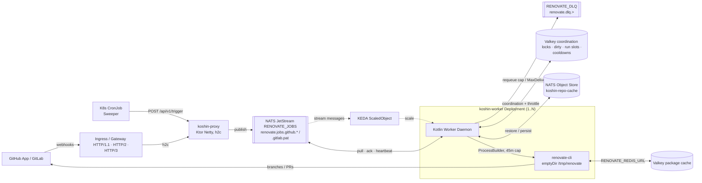
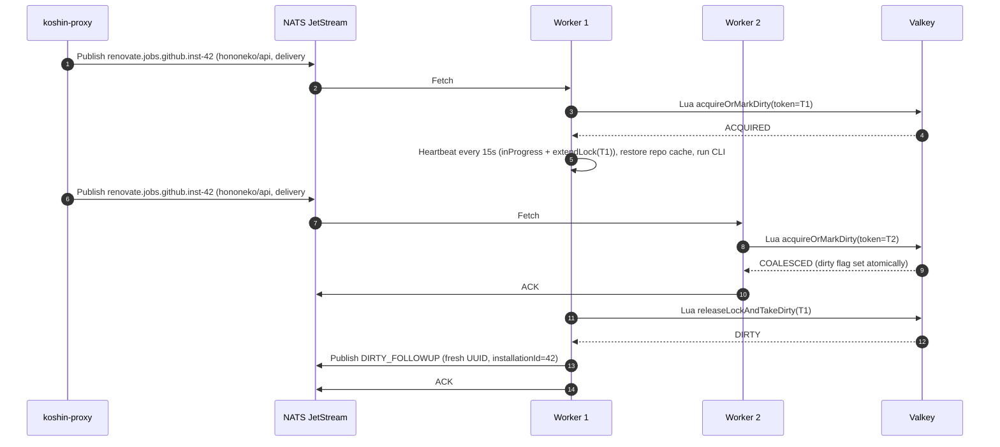

# System Architecture v3.1: `hononeko/koshin`
**Stateless, Horizontally Scalable Renovate CLI Orchestrator (Choreography & Hexagonal Design)**

## 1. System Overview & Core Principles

`hononeko/koshin` is a cloud-native, event-driven orchestrator for the open-source Mend Renovate CLI (`renovate-cli`). It overcomes the single-instance limitation of Renovate Community Edition without relying on heavy Kubernetes Job cold starts or centralized stateful coordinators.

**Monorepo:** everything lives in a single repository, **`github.com/hononeko/koshin`**: all Gradle modules, Dockerfiles, Kustomize manifests, the Helm chart, docs and CI workflows. One Conventional-Commits version (via `hononeko/actions`) covers both images and the chart.

### Architectural Pillars
1. **Choreography over Orchestration:** No central brain. A **Stateless Thin Proxy** (`:proxy`) validates and translates webhooks into queue events; **Autonomous Stateless Workers** (`:worker`) pull jobs, coordinate per-repository locks, and invoke `renovate-cli`.
2. **Hexagonal Architecture (Ports & Adapters):** Queueing, repository coordination, throttling, repo-cache sync and platform credentials live behind Kotlin interfaces in `:core`. NATS JetStream and Valkey are pluggable adapters. The queue ports follow JetStream semantics (per-message ack, in-progress heartbeat, delayed NAK); Valkey Streams fits them, while Kafka/RabbitMQ would need semantic shims.
3. **Stateless Compute:** `:proxy` and `:worker` are plain `Deployment`s with no PVCs. Workers use an `emptyDir` at `/tmp/renovate` and **delete each repo workspace and local cache after the run**. The Renovate toolchain ships in the pinned `renovate:full` image (`RENOVATE_BINARYSOURCE=global`); in-cluster **Spegel** distributes its layers P2P so cold worker pods start fast. Backing services (NATS, Valkey) come in two deployment profiles (§8).
4. **Zero Dropped Commits (Atomic Dirty-Flag Coalescing):** A worker atomically either acquires the per-repo lock **or** marks the repo dirty (single Lua script), then ACKs the duplicate. On release, the lock holder atomically releases the lock and takes the dirty flag, and schedules a single coalesced follow-up run.
5. **In-Flight Heartbeats & Fast Crash Recovery:** A heartbeat coroutine every 15s sends `msg.inProgress()` and extends the owner-tokened Valkey lock (TTL 45s). AckWait (60s) is longer than the lock TTL, so a crashed worker's lock has always expired by the time its job is redelivered. A worker that loses its lock kills its CLI process immediately.
6. **Rate-Limit Aware & Tenant-Isolated:** A global concurrency cap plus per-credential run-slot caps (`github:inst-<id>`, `github:pat`, `gitlab:pat`), Renovate per-host request limits, and per-credential exponential cooldowns keep workers from hammering Git provider APIs while isolating tenants from one another (§7).

## 2. Reference Tech Stack

* **Language & Runtime:** Kotlin **2.3+** on **JDK 25** (`kotlin { jvmToolchain(25) }`).
* **Build System:** Gradle **9.4+** multi-module build with Version Catalogs.
* **HTTP Server:** Ktor **3.x** on the **Netty** engine, `embeddedServer(Netty, configure = { enableHttp2 = true; enableH2c = true })`:
  * `h2c` (cleartext, via `Upgrade: h2c` or prior knowledge) for the in-cluster hop behind the ingress;
  * `h2` via TLS/ALPN on TLS connectors;
  * HTTP/1.1 stays available, since GitHub/GitLab webhook deliveries use it.

  Verified in Ktor 3.6.0: `enableHttp2` defaults to `true`, `enableH2c` to `false`.
* **HTTP/3 (best effort):** Ktor's engine builder doesn't expose Netty's QUIC/HTTP/3 codecs. HTTP/3 (QUIC) is terminated at the ingress/gateway (e.g. Traefik/Envoy), which routes to the proxy over h2c. A time-boxed spike (KSH-6) explores serving it directly.
* **HTTP Client & Async:** Ktor Client (`Java` engine, HTTP/2), Kotlin Coroutines, `kotlinx.serialization`.
* **Message Broker:** **NATS JetStream** (`io.nats:jnats`): `RENOVATE_JOBS` WorkQueue stream partitioned by credential scope (`renovate.jobs.<platform>.<scope>`), `RENOVATE_DLQ` stream; **JetStream Object Store** bucket `koshin-repo-cache` for Renovate repository caches.
* **State & Cache:** **Valkey** via Lettuce (coroutines), used for coordination (locks, dirty flags, run slots, cooldowns) and Renovate's package cache (`RENOVATE_REDIS_URL`). These can be separate instances.
* **Git Provider & Registry Auth:** **GitHub App** (installation tokens minted per run; public visibility gated by `GITHUB_APP_ALLOWED_ACCOUNTS`) or PAT; GitLab PAT or group token; Renovate OpenPGP-encrypted secrets (`RENOVATE_PRIVATE_KEY_PATH`) for tenant-supplied private registries.
* **Autoscaling:** **KEDA** `ScaledObject` (`metrics-api` trigger against NATS `/jsz?streams=true` `state.messages`, `targetValue: "1"`).
* **Packaging:** a Helm chart with `minimal` / `ha` profiles (primary), plus a Kustomize `minimal` reference.
* **CI/CD:** GitHub Actions using the shared composite actions in **`hononeko/actions`** (version, release notes, smoke test, publish image, snapshot pruning, and `gradle-setup`).
* **Container Images:**
  * Proxy: `eclipse-temurin:25-jre-noble`
  * Worker: pinned `ghcr.io/renovatebot/renovate:<version>-full` + Temurin 25 JRE.
* **Testing:** JUnit 5, MockK, Ktor `testApplication` / `MockEngine`, Testcontainers (NATS & Valkey), Kover coverage, Detekt static analysis.
* **Licensing:** Source **Apache-2.0**; distributed `koshin-worker` image (bundles `renovate-cli`) **AGPL-3.0**.

## 3. High-Level Topology


In the `minimal` profile, VK and VC are the same single Valkey instance.

## 4. Hexagonal Architecture & Repository Layout

### 4.1. Monorepo layout (`github.com/hononeko/koshin`)

```text
koshin/
├── .github/workflows/        # pr.yml, cd.yml, snapshot-cleanup.yml (hononeko/actions)
├── .java-version             # JDK pin read by hononeko/actions/gradle-setup (e.g. 25)
├── gradle/libs.versions.toml
├── config/detekt/detekt.yml
├── docker/ (Dockerfile.proxy, Dockerfile.worker)
├── k8s/
│   ├── base/                 # proxy, worker, scaledobject, cronjob-sweeper
│   └── overlays/
│       ├── minimal/          # 1x NATS (emptyDir), 1x Valkey (emptyDir)
│       └── ha/               # 3x NATS (R3, PVC), Valkey Sentinel (AOF, PVC)
├── charts/koshin/            # Helm chart
├── github-app/manifest.json  # GitHub App manifest
├── core/                     # dev.hononeko.koshin.core.{model,ports,usecase}, zero infra deps
├── adapters/
│   ├── nats/                 # JetStream queue, DLQ forwarder, Object Store repo cache
│   ├── state-valkey/         # RepoCoordinationPort + PlatformThrottlePort
│   └── github-app/           # GitHub App credentials + repository discovery
├── proxy/                    # Ktor (Netty) webhook & trigger server
└── worker/                   # Coroutine worker daemon + CLI runner
```

### 4.2. Core Contracts (`:core`)

```kotlin
// core.model
@Serializable enum class Platform { GITHUB, GITLAB }
@Serializable enum class TriggerReason { WEBHOOK, SCHEDULE, DIRTY_FOLLOWUP, RATE_LIMIT_REQUEUE }
@Serializable data class RepoRef(val platform: Platform, val repository: String)
sealed interface CredentialScope { // e.g. github:inst-<id>, github:pat, gitlab:pat (KSH-24)
    val platform: Platform
    val token: String              // subject/cache token: inst-<id> or pat
}
@Serializable data class RenovateJobEvent(
    val repo: RepoRef,
    val deliveryId: String,          // webhook delivery ID, otherwise ALWAYS a fresh UUID
    val triggerReason: TriggerReason,
    val rateLimitAttempt: Int = 0,   // incremented per RATE_LIMIT_REQUEUE; DLQ past MAX_RATE_LIMIT_REQUEUES
    val installationId: Long? = null, // GitHub App installation ID when running in App mode (KSH-24)
)
sealed interface JobExecutionResult {
    data object Success : JobExecutionResult
    data class Failed(val exitCode: Int) : JobExecutionResult
    data object TimedOut : JobExecutionResult
    data class RateLimited(val retryAfter: Duration?) : JobExecutionResult
}

// core.ports
interface JobQueuePublisher {
    suspend fun publish(event: RenovateJobEvent)
    suspend fun publishToDeadLetter(event: RenovateJobEvent)
}
interface JobDelivery {
    val event: RenovateJobEvent
    val deliveryAttempt: Int
    suspend fun ack(); suspend fun nack(delay: Duration = Duration.ZERO); suspend fun heartbeat()
}
interface JobQueueConsumer {
    suspend fun activeScopes(platforms: Collection<Platform>): List<CredentialScope>
    suspend fun fetchNext(scope: CredentialScope, timeout: Duration): JobDelivery?
}

enum class AcquireResult { ACQUIRED, COALESCED }
enum class ReleaseResult { CLEAN, DIRTY, NOT_OWNER }
interface RepoCoordinationPort {
    suspend fun acquireOrMarkDirty(repo: RepoRef, token: String, lockTtl: Duration, dirtyTtl: Duration): AcquireResult
    suspend fun extendLock(repo: RepoRef, token: String, ttl: Duration): Boolean
    suspend fun releaseLockAndTakeDirty(repo: RepoRef, token: String): ReleaseResult
    suspend fun releaseLock(repo: RepoRef, token: String): Boolean   // keeps dirty flag (shutdown / requeue)
}
interface PlatformThrottlePort {
    suspend fun tryAcquireRunSlot(scope: CredentialScope, token: String, ttl: Duration): Boolean
    suspend fun extendRunSlot(scope: CredentialScope, token: String, ttl: Duration): Boolean
    suspend fun releaseRunSlot(scope: CredentialScope, token: String)
    suspend fun cooldownRemaining(scope: CredentialScope): Duration?
    suspend fun registerRateLimit(scope: CredentialScope, retryAfter: Duration?): Duration
    suspend fun resetBackoff(scope: CredentialScope)
}
interface RepoCachePort {
    suspend fun restore(repo: RepoRef, scope: CredentialScope): Boolean
    suspend fun persist(repo: RepoRef, scope: CredentialScope)
}
interface PlatformCredentialsPort { suspend fun credentialsFor(repo: RepoRef): PlatformCredentials }
interface InstallationPolicyPort { suspend fun isAllowed(accountId: Long, login: String): Boolean }
interface RepositoryDiscoveryPort { suspend fun discover(): List<RepoRef> }
interface CliExecutorPort { suspend fun execute(repo: RepoRef, creds: PlatformCredentials, timeout: Duration): JobExecutionResult }
interface WorkspaceCleanerPort { suspend fun cleanup(repo: RepoRef); suspend fun purgeAll() }
```

### 4.3. Health & public endpoints
* `GET /healthz`: **liveness** only (process up, no dependency checks), so CI smoke tests can boot a single container.
* `GET /readyz`: **readiness** (proxy: NATS; worker: NATS + Valkey).
* `GET /api/v1/encryption-key`: unauthenticated on `:proxy`; serves the armored OpenPGP public key (`application/pgp-keys; charset=utf-8`) from `RENOVATE_PUBLIC_KEY_PATH` (`404` when unconfigured) so tenants can encrypt private registry secrets locally (KSH-25).

## 5. Concurrency & Dirty-Flag Coalescing Protocol

Keys use hash tags so multi-key scripts work on Valkey Cluster: `koshin:{<platform>:<repo>}:lock`, `koshin:{<platform>:<repo>}:dirty`.



### Lua scripts
```lua
-- acquireOrMarkDirty: KEYS[1]=lock KEYS[2]=dirty ARGV[1]=token ARGV[2]=lockTtl ARGV[3]=dirtyTtl
if redis.call("SET", KEYS[1], ARGV[1], "NX", "EX", ARGV[2]) then return 1 end
redis.call("SET", KEYS[2], "1", "EX", ARGV[3])
return 0

-- extendLock: KEYS[1]=lock ARGV[1]=token ARGV[2]=ttl
if redis.call("GET", KEYS[1]) == ARGV[1] then return redis.call("EXPIRE", KEYS[1], ARGV[2]) end
return 0

-- releaseLockAndTakeDirty: returns -1 NOT_OWNER, 1 DIRTY, 0 CLEAN
if redis.call("GET", KEYS[1]) ~= ARGV[1] then return -1 end
redis.call("DEL", KEYS[1])
if redis.call("GETDEL", KEYS[2]) then return 1 end
return 0

-- releaseLock (keeps dirty): KEYS[1]=lock ARGV[1]=token
if redis.call("GET", KEYS[1]) == ARGV[1] then return redis.call("DEL", KEYS[1]) end
return 0
```

## 6. Worker Job Lifecycle & Failure Handling

1. Round-robin across active credential scopes (`github:inst-<id>`, `github:pat`, `gitlab:pat`) **not in cooldown**: acquire global + per-credential run slots → `fetchNext(scope)` → release the slots if nothing was fetched.
2. `acquireOrMarkDirty` → `COALESCED`: ACK if `deliveryAttempt == 1`; if it's a redelivery (the previous holder probably crashed), NAK with `LOCK_COLLISION_RETRY_SECONDS`.
3. `ACQUIRED`: start the heartbeat (delivery heartbeat + `extendLock` + `extendRunSlot`). If `extendLock` returns false, kill the CLI.
4. `RepoCachePort.restore` → `CliExecutorPort.execute` → handle the result:

| Outcome | Lock release | Repo cache | Delivery |
| :--- | :--- | :--- | :--- |
| `Success` | `releaseLockAndTakeDirty` (DIRTY → publish follow-up) | `persist` | ACK, `resetBackoff(scope)` |
| `Failed` / `TimedOut` | `releaseLockAndTakeDirty` | not persisted | ACK (next webhook or sweep retries) |
| `RateLimited` | `releaseLock` (keep dirty) | not persisted | `registerRateLimit(scope)` → if `rateLimitAttempt < MAX_RATE_LIMIT_REQUEUES`: publish `RATE_LIMIT_REQUEUE` (fresh UUID, `rateLimitAttempt + 1`, same `installationId`), else `publishToDeadLetter`; ACK |
| Lost lock / `NOT_OWNER` | n/a | not persisted | NAK |
| Infra error (Valkey/NATS) | best effort `releaseLock` | not persisted | NAK with backoff by `deliveryAttempt` |
| SIGTERM | kill CLI, `releaseLock` (keep dirty) | not persisted | NAK(0) |

5. Always: cancel the heartbeat, `WorkspaceCleanerPort.cleanup(repo)` (deleting both `repos/` and `cache/`), `releaseRunSlot`.
6. **`MaxDeliver` exhaustion → DLQ:** every worker runs a forwarder subscribed to `$JS.EVENT.ADVISORY.CONSUMER.MAX_DELIVERIES.RENOVATE_JOBS.*` in **queue group `koshin-dlq-forwarders`**, so exactly one worker handles each advisory.
   * The advisory carries only metadata, so the forwarder reads `stream_seq` from it.
   * WorkQueue streams only delete on ACK, so the exhausted message is still stored there. It reads the original message with `jsm.getMessage("RENOVATE_JOBS", stream_seq)`.
   * It republishes to `renovate.dlq.<platform>` (`Nats-Msg-Id = dlq:RENOVATE_JOBS:<stream_seq>`, so retries can't duplicate), then calls `jsm.deleteMessage`.
   * **Sweep for missed advisories (KSH-18, KSH-24):** the advisory is core NATS, delivered at most once, so it's lost when no forwarder is subscribed (a rolling deployment) or the forwarder keeps failing. Every `NATS_EXHAUSTED_SWEEP_SECONDS` each worker iterates all consumers on `RENOVATE_JOBS` (`jsm.getConsumers`) and scans each consumer's `filterSubject` the same way. WorkQueue streams delete ACKed messages, and running jobs and jobs waiting for redelivery are ACK-pending and hold the consumer's ack floor back, while exhausted ones aren't and don't. So a job still stored is exhausted if it's at or below the ack floor, or, when nothing is ACK-pending, at or below the last delivered sequence (an exhausted job at the end of the queue never gets a later ACK to move the floor). Candidates are moved after a few seconds and only if still stored, since a just-ACKed job can stay visible briefly in a cluster. DLQ entries carry `Koshin-Dlq-Source: advisory` or `sweep`, and the DLQ deduplicates them for a day, so a move that failed after publishing can't create a second entry. Empty consumers inactive past 7 days are garbage-collected so uninstalled tenants leave no stale state.

## 7. Rate Limiting & Multi-Tenancy

* **Prevention (two-tier run slots, KSH-24):** two Valkey ZSET semaphores with leases renewed by the heartbeat—a global concurrency cap (`MAX_CONCURRENT_RUNS_GLOBAL`, `koshin:{throttle:global}:slots`) plus a per-credential cap (`MAX_CONCURRENT_RUNS_PER_CREDENTIAL`, `koshin:{throttle:<scope>}:slots`, where `<scope>` is `github:inst-<id>`, `github:pat`, or `gitlab:pat`)—paired with Renovate `hostRules` (`maxRequestsPerSecond`, `concurrentRequestLimit`) injected per run. Per-tenant API budget ≈ per-credential run slots × requests/s per run.
* **Server-side clock:** the ZSET lease scripts stay single-hash-tag and read `redis.call('TIME')` inside Lua to compute "now" and expiry, never a JVM timestamp passed as an ARGV, so pod clock skew can't corrupt leases.
* **Detection:** the CLI executor parses Renovate JSON logs for rate-limit errors (configurable pattern), since Renovate exits 0 when it aborts a repository on a rate limit: `Rate limit exceeded - aborting` on GitHub, a `Host error` with `hostType` = the platform and status 429 on GitLab. `Retry-After` / `x-ratelimit-reset` come from the logged response headers when present (secondary limits, GitLab 429s). Rate-limit signals for koshin's own HTTP calls: **429**, **403 + `x-ratelimit-remaining: 0`**, and GitHub secondary-limit responses.
* **Per-credential backoff & queue partitioning (KSH-24):** rate limits set `koshin:{throttle:<scope>}:cooldown` lasting `Retry-After`/reset time if known, otherwise `min(base × 2^n, max) ± 20% jitter` (`n` in `:backoff_n` resets on a successful run for that scope), so one installation's 403/429 never pauses other installations. Jobs publish to `renovate.jobs.<platform>.<scopeToken>` (`inst-<id>` or `pat`) on `RENOVATE_JOBS` (`WorkQueue`), each backed by its own disjoint durable pull consumer `koshin-workers-<platform>-<scopeToken>`. Workers round-robin across non-cooled-down scopes before calling `fetchNext`, so pending jobs for a cooled-down installation stay at `num_delivered = 0` (`MaxDeliver` untouched) and a tenant with hundreds of queued repos can't starve other tenants.
* **Requeue cap:** a rate-limited job is republished at most `MAX_RATE_LIMIT_REQUEUES` (default 5) times, tracked in `RenovateJobEvent.rateLimitAttempt`, then dead-lettered. Without the cap, a permanent failure that matches the rate-limit pattern would loop across cooldowns forever.
* **koshin's own HTTP calls** (GitHub App tokens, discovery) use a shared Ktor client with `HttpRequestRetry` + `exponentialDelay()` and honor `Retry-After`.
* KEDA counts pending jobs during a cooldown and may scale up idle pods; keep `maxReplicaCount` modest.

### 7.1. Multi-Tenant GitHub App, Registry Credentials & Isolation (ADR — KSH-16)

* **App visibility & installation allow-list (KSH-17):** GitHub only lets a second user or org install a GitHub App when its visibility is **Public ("Any account")**—even an operator's own personal account + org require a public App. Because GitHub provides no invite-only external visibility, Koshin enforces `GITHUB_APP_ALLOWED_ACCOUNTS` (numeric account IDs preferred over renamable logins; logins resolved to IDs on startup) and `GITHUB_APP_DISALLOWED_ACTION` (`ignore` | `suspend` | `uninstall`) across webhook ingestion, trigger/discovery, and token minting.
* **`github.com` lookups (`RENOVATE_TOKEN` vs `GITHUB_COM_TOKEN`, KSH-26):** verified in Renovate 44.178.3: `RENOVATE_TOKEN=ghs_...` registers `hostType=github` on `api.github.com`, which `github-releases`, `github-tags`, `github-digest`, changelogs, and `git` subprocesses all use—billing lookups to the tenant's installation. On `github.com` runs, the worker strips `GITHUB_COM_TOKEN` and `RENOVATE_GITHUB_COM_TOKEN` so direct `https://github.com/*` host rules (e.g. `composer`) or child processes never consume an operator fallback token; `RENOVATE_GITHUB_COM_TOKEN` is forwarded only on non-`github.com` platforms (GitLab, GHES).
* **GitHub Packages (`ghcr.io`, `*.pkg.github.com`):** GitHub Packages requires a Classic PAT (`read:packages`) outside GitHub Actions (`"enabledForGitHubApps": false` on org package endpoints in GitHub's OpenAPI spec; `401`/`403` on `maven.pkg.github.com`, `nuget.pkg.github.com`, and org-scoped `npm.pkg.github.com` / `ghcr.io` packages). Koshin does **not** request `packages: read`, auto-inject registry `hostRules` from installation tokens, or set `RENOVATE_X_GITHUB_HOST_RULES` (in Renovate, an injected `hostType` + `matchHost` rule outranks a tenant's `matchHost`-only rule and breaks working configs).
* **Tenant-supplied registry secrets via OpenPGP (KSH-25):** a Koshin-side per-installation secret store is rejected (needs tenant OAuth/RBAC, UI/API, and reversible secret storage at rest). Instead, workers mount an OpenPGP private key at `RENOVATE_PRIVATE_KEY_PATH` (plus `RENOVATE_PRIVATE_KEY_PATH_OLD` for zero-downtime rotation; raw `RENOVATE_PRIVATE_KEY` env vars are stripped so child processes don't inherit the key) and `:proxy` serves the armored public key at `GET /api/v1/encryption-key` (`RENOVATE_PUBLIC_KEY_PATH`). Tenants encrypt `{"o":"<owner>","r":"<optional-repo>","v":"<secret>"}` locally with `gpg` and commit the `encrypted` block to `renovate.json` or `{org}/renovate-config`. Verified in Renovate 44.178.3: `decryptConfig` checks `o`/`r` against the **target repository** (including on inherited/extended presets), preventing cross-tenant secret replay for both third-party registries and GitHub Packages PATs.
* **Tenant isolation & execution guardrails (KSH-21, KSH-25, KSH-26):**
  * **Untrusted code execution disabled:** Renovate holds the PGP key in memory to decrypt configs, so the worker hard-pins `RENOVATE_ALLOW_SCRIPTS=false`, `RENOVATE_ALLOWED_UNSAFE_EXECUTIONS=[]`, `RENOVATE_ALLOW_PLUGINS=false`, and `RENOVATE_ALLOW_CUSTOM_CRATE_GIT_REGISTRIES=false` alongside UID/container isolation and the worker SA `ValidatingAdmissionPolicy` (KSH-21).
  * **Repository cache (`REPO_CACHE_PROVIDER`):** `<baseDir>/cache` is wiped after every run so `<repo>.json` (dependency trees and cached private preset HTTP bodies) never lingers on `emptyDir`. Object Store keys include the credential scope (`<platform>/<scope>/<owner>/<repo>.json`) to prevent collisions across account renames or repo transfers. `REPO_CACHE_PROVIDER=s3` passes shared bucket credentials to Renovate and is single-tenant only (rejected when GitHub App auth is active).
  * **Package cache (`RENOVATE_REDIS_URL`):** `RENOVATE_CACHE_PRIVATE_PACKAGES=false` and `RENOVATE_PRESET_CACHE_PERSISTENCE=false` are hard-pinned, and `RENOVATE_REDIS_PREFIX` defaults to `koshin:<scope>:`.
  * **Log redaction:** `RenovateOutputLogger` scrubs the active per-run token and `ghs_*` / `ghp_*` / `github_pat_*` / `glpat-*` / `x-access-token:*` patterns on raw non-JSON `stderr`/`stdout` lines from child tools that bypass Renovate's Bunyan sanitizer.

## 8. Deployment Profiles

| | **minimal** | **ha** |
| :--- | :--- | :--- |
| NATS | 1 replica, `emptyDir`, stream/bucket R1 | 3-node StatefulSet + PVCs, R3 |
| Valkey (coordination) | 1 replica, `emptyDir`, shared with package cache, `noeviction` + sized `maxmemory` | Primary + replicas + 3 Sentinels, AOF on PVC, `noeviction` |
| Valkey (package cache) | same instance | separate single instance, `allkeys-lru`, `emptyDir` (it's only a cache) |
| On restart | pending jobs, locks and repo caches lost; the sweeper recovers | survives losing one node |

**Autoscaling:** KEDA's `nats-jetstream` scaler requires static consumer names, so with dynamic per-installation consumers (KSH-24) the `ScaledObject` uses KEDA's `metrics-api` scaler against NATS `/jsz?streams=true` (`streams.#(name=="RENOVATE_JOBS").state.messages`, `targetValue: "1"`). On a `WorkQueue` stream where ACKed and exhausted jobs are deleted, `state.messages` equals `sum(num_pending + num_ack_pending)` across all consumers—with 1 job per pod, workers still scale one-to-one with active + pending jobs. Kubernetes picks which pod to remove on scale-in without knowing which are busy, so workers set `controller.kubernetes.io/pod-deletion-cost` while busy (KSH-8); the SIGTERM path keeps a wrong pick safe.

Packaged as a Helm chart (`charts/koshin`, KSH-13), the primary install path: `profile: minimal` by default, `ha` via `values-ha.yaml`, with NATS (official `nats-io` chart) and Valkey (official `valkey-io` chart, Sentinel in `ha`) as subcharts or external endpoints. The Kustomize `minimal` overlay (KSH-8) stays as a dependency-free reference; there's no Kustomize `ha` overlay.

## 9. Environment Variables Contract

| Variable | Component | Default | Description |
| :--- | :--- | :--- | :--- |
| `PORT` | Both | `8080` | HTTP port (`/healthz`, `/readyz`, webhooks, `/api/v1/encryption-key`) |
| `HTTP2_ENABLED` | Both | `true` | HTTP/2 on Netty (`enableHttp2` + `enableH2c`; `h2` with TLS) |
| `LOG_LEVEL` | Both | `info` | koshin's log level (`dev.hononeko.koshin` loggers) |
| `ROOT_LOG_LEVEL` | Both | `info` | Log level of the libraries (NATS, Valkey, Ktor, ...) |
| `RENOVATE_LOG_LEVEL` | Worker | `info` | Renovate's own log level; `LOG_LEVEL` isn't passed on to Renovate |
| `PLATFORMS` | Both | `github` | Enabled platforms (`github`, `gitlab`) |
| `NATS_URL` | Both | `nats://koshin-nats:4222` | NATS connection URL |
| `NATS_STREAM_NAME` | Both | `RENOVATE_JOBS` | WorkQueue stream name |
| `NATS_STREAM_REPLICAS` | Both | `1` | Stream / Object Store replicas (`3` in HA) |
| `NATS_ACK_WAIT_SECONDS` | Worker | `60` | Must be > `LOCK_TTL_SECONDS` |
| `NATS_MAX_DELIVER` | Worker | `5` | Redelivery cap before DLQ |
| `NATS_EXHAUSTED_SWEEP_SECONDS` | Worker | `300` | How often to move exhausted jobs whose MaxDeliver advisory was missed to the DLQ (and GC idle consumers); `0` turns it off |
| `GITHUB_WEBHOOK_SECRET` | Proxy | — | HMAC secret for `X-Hub-Signature-256` (GitHub App webhook secret) |
| `GITLAB_WEBHOOK_SECRET` | Proxy | — | Shared token for `X-Gitlab-Token` (constant-time compare) |
| `INTERNAL_TRIGGER_TOKEN` | Proxy | — | Bearer token for `POST /api/v1/trigger` |
| `SWEEP_REPOSITORIES_FILE` | Proxy | — | Static repo list for discovery (when not using the GitHub App) |
| `VALKEY_URL` | Worker | `redis://koshin-valkey:6379` | Coordination Valkey (`redis://` or `redis-sentinel://`) |
| `VALKEY_SENTINEL_PASSWORD` | Worker | — | Sentinel's own password (the URL's password only applies to the Valkey nodes) |
| `VALKEY_SENTINEL_USERNAME` | Worker | — | Sentinel's ACL user (`sentinel` with the official Valkey chart, which turns the default user off) |
| `RENOVATE_REDIS_URL` | Worker | `$VALKEY_URL` | Renovate package cache Valkey (`RENOVATE_REDIS_PREFIX` defaults to `koshin:<scope>:`; private package/preset caching pinned off) |
| `LOCK_TTL_SECONDS` | Worker | `45` | Per-repo lock TTL |
| `HEARTBEAT_INTERVAL_SECONDS` | Worker | `15` | Heartbeat / lock / run-slot renewal interval |
| `DIRTY_TTL_SECONDS` | Worker | `3600` | Must be > `CLI_TIMEOUT_MINUTES` |
| `LOCK_COLLISION_RETRY_SECONDS` | Worker | `30` | NAK delay for a redelivered job that hits a held lock |
| `CLI_TIMEOUT_MINUTES` | Worker | `45` | Hard cap per `renovate-cli` run (`+ 5` must stay < 60 for GitHub App tokens) |
| `RENOVATE_BASE_DIR` | Worker | `/tmp/renovate` | Workspace (`emptyDir`; `repos/` and `cache/` deleted after every run) |
| `RENOVATE_BINARYSOURCE` | Worker | `global` | Tools come from the `full` image |
| `REPO_CACHE_PROVIDER` | Worker | `nats` | `nats` (Object Store sync, scoped as `<platform>/<scope>/<repo>.json`), `s3` (native Renovate, single-tenant PAT mode only), `local` |
| `REPO_CACHE_BUCKET` | Worker | `koshin-repo-cache` | Object Store bucket |
| `REPO_CACHE_MAX_BYTES` | Worker | — (unlimited) | Bucket size cap; uploads are skipped while it's full |
| `REPO_CACHE_TTL_DAYS` | Worker | — (forever) | Drops caches of repos without a successful run for this long |
| `RENOVATE_CACHE_DIR` | Worker | `$RENOVATE_BASE_DIR/cache` | Renovate's cache dir; wiped after every run once `persist` completes |
| `RENOVATE_REPOSITORY_CACHE_TYPE` / `RENOVATE_S3_ENDPOINT` / `RENOVATE_S3_PATH_STYLE` | Worker | — / — / `true` | Used when `REPO_CACHE_PROVIDER=s3` (`s3://<bucket>/<prefix>/`); the legacy `RENOVATE_X_S3_*` names are accepted |
| `MAX_CONCURRENT_RUNS_GLOBAL` | Worker | `6` | Global run-slot cap across all credentials |
| `MAX_CONCURRENT_RUNS_PER_CREDENTIAL` | Worker | `2` | Per-credential (`github:inst-<id>`, `github:pat`, `gitlab:pat`) run-slot cap (`MAX_CONCURRENT_RUNS_PER_PLATFORM` accepted as legacy alias) |
| `RENOVATE_MAX_REQUESTS_PER_SECOND` | Worker | — | Injected into Renovate `hostRules` |
| `RENOVATE_CONCURRENT_REQUEST_LIMIT` | Worker | — | Injected into Renovate `hostRules` |
| `RATE_LIMIT_BACKOFF_BASE_SECONDS` | Worker | `60` | Cooldown base |
| `RATE_LIMIT_BACKOFF_MAX_SECONDS` | Worker | `3600` | Cooldown cap |
| `MAX_RATE_LIMIT_REQUEUES` | Worker | `5` | Rate-limit requeues per job before it's dead-lettered |
| `RATE_LIMIT_LOG_PATTERN` | Worker | `^Rate limit exceeded - aborting$` | Regex for the Renovate log message of a run aborted by the platform's rate limit |
| `GITHUB_APP_ID` / `GITHUB_APP_PRIVATE_KEY_PATH` | Both | — | GitHub App auth (preferred) |
| `GITHUB_APP_ALLOWED_ACCOUNTS` | Both | — | Comma-separated GitHub user/org IDs or logins allowed to use a public App (KSH-17; unset = allow all with startup warning) |
| `GITHUB_APP_DISALLOWED_ACTION` | Both | `ignore` | Action for non-allowed installations: `ignore`, `suspend`, or `uninstall` (KSH-17) |
| `GITHUB_TOKEN` | Worker | — | PAT fallback when the App isn't configured |
| `GITHUB_API_URL` | Both | `https://api.github.com` | GHES support |
| `GITLAB_TOKEN` / `GITLAB_ENDPOINT` | Worker | — | GitLab credentials |
| `RENOVATE_GITHUB_COM_TOKEN` | Worker | — | Forwarded only on non-`github.com` runs (GitLab / GHES) for release-note lookups; stripped on `github.com` runs |
| `RENOVATE_PUBLIC_KEY_PATH` | Proxy | — | Armored OpenPGP public key served at `GET /api/v1/encryption-key` (KSH-25) |
| `RENOVATE_PRIVATE_KEY_PATH` / `RENOVATE_PRIVATE_KEY_PATH_OLD` | Worker | — | OpenPGP private key (and previous key during rotation) for Renovate `encrypted` secrets (KSH-25) |

## 10. Changelog v3.0 → v3.1
* Atomic `acquireOrMarkDirty`; owner-tokened locks; lost lock kills the CLI.
* Timings: lock TTL 45s, heartbeat 15s, AckWait 60s; NAK on redelivery collision.
* Fresh UUIDs for follow-up, schedule and requeue events (NATS dedup).
* `platform` added to the event and keys; per-platform subjects/consumers (lossy repo-in-subject mapping removed); hash-tagged keys.
* Proxy filters out Renovate-triggered webhooks.
* Failure-handling matrix; DLQ for `MaxDeliver` exhaustion via a queue-grouped advisory forwarder (`getMessage` by `stream_seq` → DLQ → `deleteMessage`).
* Rate-limit requeues capped by `rateLimitAttempt` / `MAX_RATE_LIMIT_REQUEUES`, then dead-lettered.
* Run-slot leases use Valkey's `TIME`, not JVM clocks.
* LRU disk manager dropped (workspace deleted per run); `renovate:full` + Spegel + `binarySource=global`.
* Repository cache via NATS Object Store sync (or native S3).
* Rate limiting & backoff (§7); GitHub App auth & discovery (token reuse threshold `CLI_TIMEOUT_MINUTES + 5 min` within GitHub's 60-minute lifetime).
* Deployment profiles `minimal` / `ha`; Helm chart; KEDA `lagThreshold: "1"` (ack-pending counted) + pod-deletion-cost.
* Module `:adapters:queue-nats` renamed to `:adapters:nats`; new `:adapters:github-app`.
* Monorepo `hononeko/koshin`; CI via `hononeko/actions` (+ new `gradle-setup`), Detekt + Kover gates.
* HTTP server: CIO replaced by Netty with HTTP/2 (`enableHttp2` + `enableH2c`, verified in Ktor 3.6.0); HTTP/3 at the ingress.
* `/healthz` (liveness, no deps) split from `/readyz` (readiness).
* Multi-tenant GitHub App ADR (KSH-16 → KSH-17, KSH-24, KSH-25, KSH-26): two-tier (`global` + `CredentialScope`) run slots and per-credential cooldowns; disjoint `renovate.jobs.<platform>.<scope>` consumers + KEDA `metrics-api` stream scaling; OpenPGP `encrypted` registry secrets (`RENOVATE_PRIVATE_KEY_PATH` + `GET /api/v1/encryption-key`, no `ghs_` `hostRules` auto-injection); `GITHUB_COM_TOKEN` stripping on `github.com`, per-run `cacheDir` wipe, scoped repo/package caches, log token scrubbing, and pinned untrusted-execution bans.
